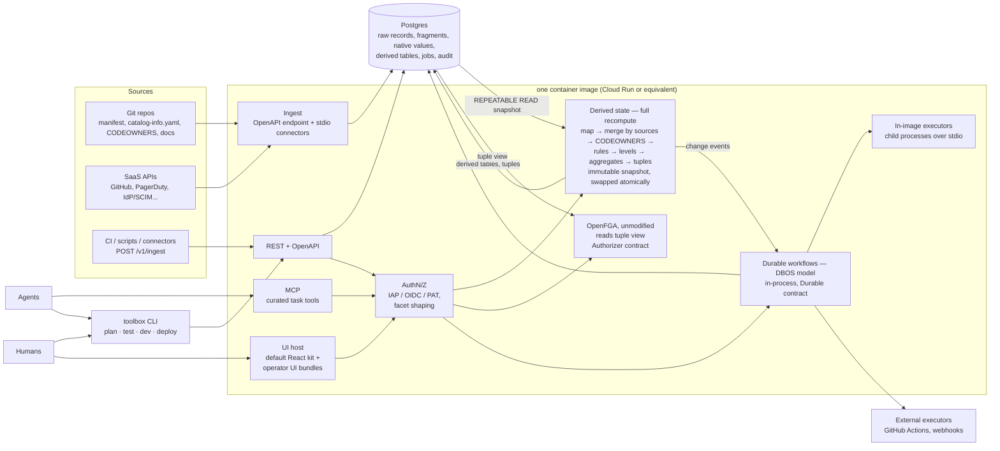

# Toolbox — Architecture & Delivery Plan

> An open-source, agent-first internal developer portal (IDP) framework. The core is written in Rust,
> it is configured entirely in code, and it is deployed by you.
> Companion document: [research.md](./research.md) (landscape, competitor analysis, validation).

---

## 1. Thesis

A Toolbox portal is a **build artifact of a git repository**. A platform team or an agent writes a
**manifest** in YAML, or a TypeScript program that prints one with the typed builder
([typescript-builder.md](./design/typescript-builder.md)). The manifest pins a Toolbox version and
declares connectors, kinds, scorecards, permissions, actions and UI bundles. Then they run:

```
toolbox validate → toolbox test → toolbox plan → toolbox build → deploy one image → toolbox verify
```

The resulting server exposes **the same capabilities through four interfaces (API, MCP, CLI, UI)**,
generated from one definition, with one authorization model. Agents are the primary user. Humans get
the same truth through a fast, mostly read-only UI.

### Charter goals (added 2026-11-20, D33–D35)

These three goals constrain every other design choice. Where an older section of this plan conflicts
with them, they win, and [decisions.md](./decisions/README.md) records the change.

- **G1. Simple deployment.** The default deployment is **one container image plus Postgres**, runnable
  on Google Cloud Run or an equivalent. Custom UIs and self-service action code ship *inside* that
  image, not as separate Kubernetes pods or microservices to wire together. Modular deployment (split
  API and worker roles, external OpenFGA, external executors) is available but never required.
- **G2. Agent SDLC.** Agents can **plan, build, test, deploy and monitor** at the maturity of regular
  programming or force.com, at each of three layers ([sdlc.md](./sdlc.md), D63):
  - **maintainer SDLC:** building Toolbox itself, with executable exit criteria and a reference-model
    oracle ([maintainer-sdlc.md](./design/maintainer-sdlc.md));
  - **operator SDLC:** building a portal: local dev, tests, previews, reviewed plans, deploys,
    rollbacks, monitoring ([design/sdlc.md](./design/sdlc.md)). This is the main counterpoint to Port
    and Backstage, whose configuration lifecycles lack that maturity;
  - **user SDLC:** building apps on a portal's context and actions, against stable contracts with
    reproducible reads ([user-sdlc.md](./design/user-sdlc.md)).
- **G3. Replaceable components.** React, DBOS, OpenFGA's packaging, the derived-state engine and the
  monitoring vendors are good defaults, not lock-ins. Each sits behind a Toolbox-owned contract (a Rust
  trait, a protocol or a UI mount contract) with conformance tests, so it can be replaced when better
  technology arrives.

The v1 architecture is the **minimal architecture** from [technology-critique.md](./technology-critique.md)
§8, amended by these goals (D36–D47): one Rust binary, Postgres, OpenFGA inside the same container,
derived state by full recompute, durable workflows in-process.

### Goals
1. Agents can **author** a portal: they write the config, test it, preview its effects and upgrade it,
   without bespoke knowledge.
2. Agents can **use** a portal: find, understand, assess and act on the software estate within a token
   budget, with safe side effects.
3. The portal scales to **10k+ services, 100k+ entities, 10k+ users** on boring infrastructure
   (Postgres + stateless replicas). Every derived value is **recomputed from a consistent snapshot
   whenever its inputs change**: about 3 s at 100k entities and 2M relations
   ([technology-critique.md](./technology-critique.md) §7.1). There is no batch or nightly
   recomputation. An incremental engine (DBSP) can replace full recompute behind the same contract if
   a real portal needs it (D37).
4. Extensions use **the right language for each job**, optimised for the agent developer experience
   (v1 scope per D41):
   - a YAML/JSON manifest, optionally produced by a TypeScript typed builder, for configuration
   - CEL for predicates and mappings
   - any language for connectors and executors, including in-image executors over stdio (D40)
   - custom UIs through a framework-agnostic UI extension contract, with React (TSX) on the
     `@toolbox/ui` design system as the default kit ([frontend.md](./design/frontend.md))
   - deferred: Python SDK, Pulumi-style language hosts, WASM functions

   ([extensibility.md](./design/extensibility.md))
5. Upgrading Toolbox is a **version bump**, not a merge of scaffolded code.
6. Operators get boring, observable operations:
   - only Postgres to back up (object storage is optional, for doc assets and archives)
   - documented metric and event catalogs
   - shipped dashboards, alerts and runbooks
   - **replaceable monitoring vendors**: Grafana and PostHog are the reference backends, not
     dependencies

### Non-goals
- **Runtime configuration stored in a database.** There is no admin UI for blueprints, scorecards or
  actions, and the server refuses runtime config mutation. *Catalog data* may be stored natively, but
  only for fields the schema (in code) declares `native`
  ([source-of-truth.md](./design/source-of-truth.md)).
- A hosted SaaS, a plugin marketplace that runs arbitrary code in-process, a drag-and-drop dashboard
  builder, or **user-authored dashboards inside Toolbox**. Ad-hoc dashboards are built in Claude
  Artifacts, Cursor Canvas and similar tools over the Toolbox MCP server. UI customisation is for
  operators only, in code ([dashboards.md](./design/dashboards.md)).
- Toolbox *as a service* hosting customers' code (the Salesforce Functions lesson). Customers deploy
  their own image, so their action executors and UI bundles may ship inside it (G1, D40); Toolbox never
  runs other organisations' code.
- Engineering-metrics analytics (DORA, surveys). Toolbox *ingests* such facts as inputs; it does not
  compete with DX-style analytics.
- Running agents. Toolbox *informs and governs* agents; runners such as Claude Code or engrams can
  trigger Toolbox actions.

### The core split: config vs. state (borrowed from Terraform)

| **Config (in git, immutable per deploy)** | **State (in Postgres, changes at runtime)** |
|---|---|
| Kinds and schemas, relation types, **per-field source of truth** | **Inputs (written once):** raw connector records, native field values with revisions |
| Connector declarations and mappings | Connector cursors, sync status (durable workflow state) |
| Scorecards, rules, levels, initiatives, waivers | **Derived views (never written as source data):** entities, relations, authz tuples, rule outcomes; plus an archive of their deltas for history |
| Actions, executors, approval rules, automations | Action runs, approvals given, logs |
| Authorization model (OpenFGA DSL), derivation rules, roles | Sessions, tokens, audit log |
| UI views, navigation, branding | Search indexes, embeddings, doc renders |
| Docs sources | Docs content (re-derivable) |

**Every fact is written exactly once.** Entities, relations, tuples, scores and search documents are
views recomputed from a consistent snapshot of the inputs (D37)
([incremental-computation.md](./design/incremental-computation.md)). The only irreplaceable state is:
- the audit log
- workflow and run history
- **native data** (fields the schema declares Toolbox-owned), which is also mirrored to git and
  exportable

Everything else can be rebuilt by replaying the log.

---

## 2. What a customer's portal repo looks like

*Rewritten 2026-11-20 for v1 (D41, D53–D55). The runnable example is the
[reference portal](../examples/reference-portal/README.md); the builder is specified in
[typescript-builder.md](./design/typescript-builder.md).*

```
acme-portal/
├── toolbox.yaml              # the manifest (or toolbox.config.ts using @toolbox/manifest)
├── policies/*.yaml           # optional files merged via `include` (e.g. security-owned approved apps)
├── toolbox.lock              # pinned Toolbox version and connector/executor digests
├── authz/model.fga           # OpenFGA model + *.fga.yaml tests (run over derived tuples)
├── fixtures/                 # connector-record fixtures (NDJSON) + native values
├── tests/*.test.yaml         # CEL expectations over entities, scores, options
├── connectors/, executors/   # optional custom connectors and in-image executors (any language)
├── ui/<bundle>/              # optional operator UI bundles (React by default)
├── Dockerfile                # FROM the Toolbox base image; one image (G1)
├── .github/workflows/        # validate → test → plan on PRs; build → deploy → verify on main (G2)
├── CODEOWNERS                # owners of policies, authz and modules
└── AGENTS.md                 # generated by `toolbox init`
```

**How it works:** `toolbox build` turns the source (one YAML file, YAML files joined by `include`, or a
TS program) into **one canonical, key-sorted `manifest.json`** and bakes it into the image. The server
loads only that file, refuses runtime configuration changes (D2) and resolves `${env:…}` and
`${secret:…}` placeholders at start-up (D55). `toolbox plan` diffs two manifests over one snapshot.
There is no per-portal code generation and no language host at runtime.

The Pulumi-style design that preceded this (language hosts, a config monitor, SDKs in many
languages) is deferred (D41); its rationale is kept in
[extensibility.md](./design/extensibility.md)'s appendix.

## 3. System architecture

**v1 baseline (D36–D45):** one container image (`toolbox serve`) plus Postgres. Everything in the box
below ships in that image. Dashed components are defaults behind Toolbox-owned contracts (G3).



`toolbox plan` runs two full recomputes (current and candidate manifest) over one snapshot and diffs
scores, ownership, tuples and mappings. The snapshot id is the consistency token returned to clients.

**Sprawl budget (D45):** ≤ 2 implementation languages in the default image (Rust; Go only inside the
OpenFGA component), no required runtime service besides Postgres, ≤ 3 author-facing languages
(manifest, CEL, OpenFGA DSL; TypeScript optional). Additions need an ADR with a measurement.

**Replaceable contracts (G3):**

| Contract | v1 default | Possible replacements |
|---|---|---|
| `DerivedState` | Full recompute in Rust | DBSP incremental circuit; Postgres materialised views (measured equal, §7.1 of the critique) |
| `Authorizer` | OpenFGA inside the container (packaging: Q11) | External OpenFGA; another Zanzibar engine passing the `.fga.yaml` corpus |
| `Durable` | DBOS-model workflows on Postgres (Q4) | DBOS Rust SDK; Temporal/Restate for modular deployments |
| UI extension contract | React + `@toolbox/ui` + Storybook | Any framework that builds a static ES module / Web Component bundle |
| Executor protocol (stdio / HTTP) | In-image child processes; GitHub Actions | Any executor speaking the protocol |
| Telemetry sinks | OTel/Prometheus → Grafana; PostHog | Any OTLP or HTTP sink |

### Rust workspace (crates)

*The table below is the full-scope design. **v1 status (D37–D44):** `toolbox-ivm` becomes
`toolbox-derive` (full recompute behind `DerivedState`); `toolbox-changelog`, `toolbox-wasm`,
`toolbox-graphql`, `toolbox-sim`, `toolbox-gen`, tantivy in `toolbox-search`, the language hosts in
`toolbox-config` and every SDK except TypeScript are **deferred**; `toolbox-tcp` shrinks to the ingest
API and the stdio executor/connector transport; `toolbox-fga` becomes the OpenFGA packaging (Q11).*

| Crate | Responsibility | Key dependencies |
|---|---|---|
| `toolbox-model` | Entity envelope, refs, kinds, relation types, JSON Schema validation, manifest IR types | serde, jsonschema |
| `toolbox-config` | Config monitor (receives `Register` calls from language hosts), language-host process management, package resolution, lockfile, manifest emission | tonic/axum |
| `toolbox-schema` + `toolbox-codegen` | The Toolbox schema for every built-in resource type; generates SDKs (TS, Python, Go, C#, Java), docs and JSON Schema | — |
| `sdk/*` (non-Rust) | Thin per-language runtimes plus generated types; language hosts | npm, PyPI, Go, NuGet, Maven |
| `toolbox-tcp` | Toolbox Connector Protocol: spec, conformance kit, Rust client/server; SDKs per language | axum, reqwest |
| `toolbox-expr` | Typed CEL: compile, type-check against kind schemas (Salsa-memoised for CLI/LSP), object construction for mappings, cost estimation | cel (cel-rust), salsa |
| `toolbox-store` | Input tables (raw records, native values, audit), migrations, `MemStore` with modelled isolation | sqlx |
| `toolbox-changelog` | Commit-ordered change log via Postgres logical decoding; log positions as consistency tokens | sqlx / pgwire replication |
| `toolbox-ivm` | **The incremental circuit**: compiles the manifest to a DBSP circuit (mapping, merge by `sources`, relations, recursive closures, tuples, rule outcomes, levels, rollups, facet labels, search documents); epochs; checkpoints; history-delta archive | **dbsp** (MIT) |
| `toolbox-durable` | Durable execution (DBOS model): workflows and steps checkpointed in Postgres, queues, scheduled workflows; behind a `Durable` trait | **dbos** Rust SDK (or a schema-compatible minimal runtime) |
| `toolbox-ingest` | Connector runtime (process protocol, push API), sync workflows, cursor and snapshot bookkeeping, deletion safety valves | tokio |
| `toolbox-graph` | Query layer over the circuit's indexed views: neighbours, paths, impact, ownership | — |
| `toolbox-score` | Scorecard definitions → circuit operators; explain; waivers; initiatives | toolbox-ivm, toolbox-expr |
| `toolbox-actions` | Action registry, executors, run workflows, approvals, idempotency, automations, templates | toolbox-durable, minijinja |
| `toolbox-knowledge` | Docs/schema ingest, Markdown render, chunking, embeddings, context packs | comrak, pulldown-cmark |
| `toolbox-search` | Unified index, hybrid ranking (BM25 + vectors with RRF), permission filtering | tantivy, pgvector / usearch |
| `toolbox-authz` | Identity-aware-proxy JWT verification, OIDC, PATs, MCP OAuth 2.1; facet shaping with information-flow labels; CODEOWNERS authority; result caches per log position; explain; AuthZEN endpoint; audit | openidconnect, jsonwebtoken |
| `toolbox-fga` (Go) | **Embedded OpenFGA** (`pkg/server`) with a read-only datastore over the circuit's tuple index; built as a c-archive and called through a batched C ABI | openfga/openfga |
| `toolbox-wasm` | wasmtime host, WIT worlds, fuel/memory limits, component cache | wasmtime |
| `toolbox-api` | axum REST, OpenAPI 3.1 (generated per portal), SSE changefeed, outbound webhooks | axum, utoipa |
| `toolbox-graphql` | Read-only GraphQL: dynamic schema from the manifest, trusted-document registry, cost analysis, batched authorization/facet loaders, GET + ETag | async-graphql (`dynamic-schema`) |
| `toolbox-mcp` | MCP server (Streamable HTTP + stdio bridge), tools/resources/prompts/elicitation/tasks | rmcp |
| `toolbox-ui` | Embedded SPA assets and the server side of view rendering | rust-embed |
| `toolbox-cli` | `toolbox` binary: authoring commands + remote client | clap |
| `toolbox-telemetry` | OTel setup (traces/metrics/logs), metric catalog, analytics event catalog, `AnalyticsSink` adapters (PostHog, OTLP, HTTP, file), PII scrubbing | opentelemetry, tracing |
| `toolbox-ops` | Admin API, `/mcp/ops`, health model, dashboard/alert/SLO generators (Grafana renderer first) | — |
| `toolbox-synth` | Synthetic-organization generator for benchmarks and tests | — |
| `toolbox-env` | The single seam for nondeterminism (clock, rng, net, store, spawn, proc, fs); `buggify!`; `always!`/`sometimes!` assertion facade | — |
| `toolbox-ref` | Executable reference models (merge, identity, derivation, scoring, shaping, native store, plan); the full-pipeline oracle `expected(world, manifest, native_history)` | — |
| `toolbox-sim` | Deterministic simulation: multi-replica cluster on `MemStore` + faults; simulated sources, executors, IdP, agents; chaos → quiescence → liveness phases; seed replay | turmoil |
| `toolbox-gen` | Generators of random valid portals (manifests, OpenFGA models, CEL rules) and matching worlds for configuration-space testing | proptest/bolero |

**Architecture rules:**
- **Functional core, imperative shell.** All nondeterminism goes through `toolbox-env`, so deterministic
  simulation stays possible when it is needed ([verification.md](./design/verification.md) §3; deferred
  by D44).
- **Every replaceable component sits behind a Toolbox-owned contract with a conformance suite (G3).**
- **No per-portal code generation, ever.** The recompute pipeline is built at runtime from the manifest
  over one dynamic row type, and CEL is interpreted. This avoids the multi-minute compile loop Feldera
  had to engineer its way out of.
- **Small, shallow workspace:** interface crates separate from implementations; heavy dependencies
  isolated in leaf crates; `dyn` at crate boundaries. Velocity tooling such as `cargo hakari` comes back
  only when workspace size needs it (D44).

  Fast inner loops for maintainers and operators are a measured requirement
  ([developer-velocity.md](./design/developer-velocity.md)).

A single binary runs as `toolbox serve --role all|api|worker`; `all` is the default (G1).
- **Every instance recomputes the same snapshot** from Postgres, so state at a given snapshot id is
  identical everywhere.
- **Any instance can execute durable workflows**; a split worker role is optional.
- **Dependencies:** Postgres only. There is no Redis, Kafka, Elasticsearch or required object storage.

---

## 4. Pillar designs

### 4.1 Catalog & knowledge graph

**Entity envelope.** Toolbox uses the Backstage envelope so `catalog-info.yaml` imports unchanged, and
adds:

```yaml
apiVersion: toolbox.dev/v1          # backstage.io/v1alpha1 also accepted
kind: Service
metadata: { name, namespace, title, description, labels, annotations, tags, links }
spec: { ... }                       # validated against the kind's JSON Schema from config
relations: [ { type, targetRef, source, confidence } ]       # derived, never authored directly
status:
  scorecards: { production-readiness: { level: silver, passed: 7, failed: 2, skipped: 1 } }
  errors: [ ... ]
provenance: { "spec.owner": { source: "git:acme/payments/catalog-info.yaml", at: "...", confidence: 1.0 } }
```

> **v1 (D37):** mapping, merge, relations and closures run in the full-recompute pipeline
> ([v1-spec.md](./v1-spec.md) §6, reference model in [examples/reference-portal](../examples/reference-portal/README.md)).
> Where this section says "circuit", read "derived-state pipeline"; the incremental properties
> (only changed entities propagate) belong to the deferred engine. The Python example below shows a
> deferred SDK; the v1 equivalent is the reference manifest.

**Multi-source merge (fixes a Backstage limitation).** Connectors emit raw records; the circuit maps
them to *fragments* keyed by entity identity. The merge is a **circuit operator**: a pure,
deterministic, incrementally maintained function with these properties:
- Field-level precedence is declared in config, as each kind's **`sources`** list (e.g. `owner` comes
  from `catalog-info`, then `native`, then inference). The same declaration governs writes: native
  fields are edited in Toolbox, git-owned fields get a PR, and connector-owned fields are read-only
  ([source-of-truth.md](./design/source-of-truth.md)).
- Arrays and sets are canonicalized, which prevents the hash churn Backstage warns about.
- Only changed entities propagate downstream. This is inherent to the incremental circuit (Z-set
  deltas).
- Pure WASM *transforms* can run in the merge step, so it is extensible, unlike Backstage stitching.
- **Permission-relevant claims** (`spec.owner`, external ids) apply only when backed by CODEOWNERS
  ([authorization.md](./authorization.md) §4.8).
- The ingest path never calls out to the network, following Backstage's processing-loop lesson.

**Deletion semantics.** Connectors declare `full` or `incremental` sync. After a full sync, a
`SNAPSHOT_COMPLETE` marker deletes that source's fragments that were not seen. An entity disappears
when its last fragment is gone, unless policy says to keep it as an orphan with a status flag.

**Kinds.** Default model = Backstage kinds, plus `Repository`, `Environment`, `Deployment`, `Agent`,
`MCPServer` and `Skill`/`Rule`. The last three follow Backstage's `AiResource` and `mcp-server` API type,
so the portal can catalog and distribute agent standards. Custom kinds support Port-grade expressiveness
*in code*: typed props, relations with cardinality, `mirror`, `calc` (CEL) and `aggregate` properties,
and inherited ownership.

**Graph.**
- Relations are a circuit view, indexed in memory in both directions.
- Recursive closures are maintained incrementally by the circuit. Examples: nested group membership,
  inherited ownership, `dependsOn` reachability, system and domain roll-ups.
- Queries:
  - `neighbors(ref, types, depth)`
  - `path(a, b)`
  - `impact(ref)`: reverse-dependency closure with owners
  - `owners(ref | repo path)`: CODEOWNERS-aware
- Derived edges carry `source` and `confidence`. Examples: dependencies from SBOMs and lockfiles,
  API consumption from OpenAPI clients, and runtime calls from traces via connectors.

**Facts.** Connectors can push typed time-stamped facts (e.g. `coverage=81.2`, `open_vulns.critical=0`,
`last_deploy_at`). These follow the OpsLevel custom-event and Datadog outcome patterns. Facts are kept
as latest value plus a bounded history, and are usable by scorecard rules and views.

### 4.2 Scorecards

Shown with the Python SDK as `from toolbox_sdk import *`. Every SDK has the same shape.

```python
scorecard("production-readiness",
    applies_to = "entity.kind == 'Service' && entity.spec.lifecycle == 'production'",
    levels = [level("bronze"), level("silver"), level("gold")],        # progressive, Cortex/OpsLevel style
    rules = [
        rule("has-owner", level = "bronze", check = "has(entity.spec.owner)",
             fix = "Add `spec.owner` to catalog-info.yaml", remediation = "action:set-owner"),
        rule("has-runbook", level = "silver",
             check = "entity.metadata.links.exists(l, l.type == 'runbook')"),
        rule("oncall-configured", level = "silver",
             applies_if = "entity.spec.tier in ['0','1']",              # otherwise outcome = skip
             check = "has(entity.spec.oncall)"),
        rule("no-critical-vulns", level = "gold", check = "facts['snyk.critical'] == 0",
             stale_after = "7d"),                                      # unknown if fact is stale
        rule("sast-policy", level = "gold", check = extension("sast-policy")),  # a function in any language (§4.6)
    ],
    waivers = [waiver("service:default/legacy-billing", rule = "has-runbook",
                      until = "2027-03-31", reason = "Decommission Q1")],
)
campaign("tier1-oncall", track = "reliability",
         includes = [include("production-readiness", at_least = None, rules = ["oncall-configured"])],
         end = "2027-01-31", owner = "group:default/sre", target_percent = 100)
# Soundcheck campaigns / Cortex initiatives / OpsLevel campaigns — see design/campaigns.md
```

- **Outcomes** are `pass | fail | skip | unknown`, with a remark. `skip` and `unknown` come from
  Datadog's outcome model and are essential for honest explanations to agents.
- **Rule languages, in tiers:**
  1. **CEL** inline: covers ~90% of rules. It is type-checked at `toolbox build` against kind schemas.
  2. **WASM functions** for complex logic, written in TypeScript or Rust (§4.6).
  3. **SQL-style aggregate rules**: cross-entity checks expressed as circuit queries, the pattern DX
     validated.
- **Evaluation** *(v1: full recompute from a snapshot, D37; the circuit text below is the deferred
  path)*. **Incremental evaluation is the circuit.** Rules are operators, and outcomes update as their inputs
  change, with no invalidation logic to maintain by hand. A scorecard config change creates a new
  circuit epoch, built in the background from a checkpoint and the log, then cut over atomically. Only
  the operators the manifest diff touches recompute.
- **Information flow:** outcomes carry the facet labels of their inputs. Making outcomes public
  requires an explicit `declassify` ([authorization.md](./authorization.md) §4.2).
- **`toolbox plan` score diff:** the killer feature for agents and reviewers. `toolbox plan --remote
  https://portal.acme.dev` uploads the new manifest (config only), and the portal evaluates it
  **server-side** against current state. No production data reaches CI. Plan output is posted to the
  PR, and access to the portal repo is the boundary, as with Terraform ([sdlc.md](./design/sdlc.md) §4). It reports, for example:
  "+1 rule; 214 services drop silver→bronze; 3 waivers expire before deadline".
- **Explain:** for every failing rule, return the expression, the observed values, the provenance of
  those values, the `fix` text, and a linked remediation action. This feeds MCP `explain` and the UI.

### 4.3 Self-service actions

- **Definition:**
  - name, agent-facing description, input and output JSON Schemas (Backstage Scaffolder and Port both
    use JSON-Schema inputs)
  - executor, policy, approvals (`any`/`all` of groups, Port-style), timeouts and concurrency keys
  - annotations: `read_only`, `destructive`, `idempotent`, which map 1:1 to MCP tool annotations
> **2026-11-20 (D40, D49):** run lifecycle, preview/confirm and verification are now defined in
> [action-runs.md](./design/action-runs.md): a run succeeds only when its postconditions are observed.
> In-image executors (child processes over stdio) are the default for rich actions; `wasm` is deferred.

- **Executors:** built-in executors are listed below. All *side effects run outside the server
  process* (in-image executors are separate child processes).
  - `webhook` (HMAC-signed)
  - `github_workflow` (workflow_dispatch) and `gitlab_pipeline`
  - `argo_workflow` and `k8s_job`
  - `template`: MiniJinja render of a template repo, then a PR or new repo, then registration in the
    catalog
  - `pull_request`: apply a patch and open a PR
  - `wasm`: sandboxed; host-granted HTTP only *(deferred, D41)*
  - `in-image`: a child process in the portal image over stdio *(v1 default for rich actions, D40)*
- **Runs are durable workflows** (DBOS model, [incremental-computation.md](./design/incremental-computation.md) §4).
  - States: `pending → awaiting_approval → running → succeeded | failed | cancelled`.
  - Each step is checkpointed in Postgres; approval waits and timeouts are durable.
  - Idempotency keys, logs streamed over SSE, and callbacks for external executors (signed run
    tokens).
- **Dry-run is mandatory to declare.** An action declares `dry_run = "native" | "validate_only"`. Agents
  always see what a run *would* do before doing it: the rendered template diff, the target workflow and
  inputs, and the approval path.
- **Automations:** triggers on entity events, score transitions, fact thresholds and schedules (Port
  automations), filtered with CEL. Examples: "when a tier-1 service drops below silver, open a Jira
  ticket"; "when a repo is created, run catalog bootstrap".
- **Templates/golden paths** are actions, not a separate subsystem.

### 4.4 Knowledge ("context lake"), docs and search

> **v1:** entity search uses Postgres full-text search ([v1-spec.md](./v1-spec.md) §2); tantivy, vectors, docs and the context lake are Phase 4.

- **Sources:**
  - Markdown docs in repos, with `mkdocs.yml` nav honoured for TechDocs migration
  - READMEs, ADRs and runbooks
  - API specs: OpenAPI, AsyncAPI, protobuf, GraphQL SDL
  - `CODEOWNERS`, `AGENTS.md`/`CLAUDE.md`
  - incidents and postmortems, via connectors
- **Pipeline:** fetch → parse → render (Rust: comrak, GFM; Mermaid client-side) → heading-aware chunking
  → **link to entities** (repo/path ownership, annotations, explicit front-matter) → index.
- **Search:** one index for entities, doc chunks, API operations, actions and scorecard rules.
  - Uses **tantivy** (BM25, facets, fuzzy matching), plus optional vectors: pgvector in Postgres mode,
    an embedded HNSW in SQLite mode.
  - Results are fused with reciprocal-rank fusion, boosted by graph proximity to the caller's teams.
  - Permission filtering is applied before results leave the server.
  - Indexes are per replica, fed by the circuit's search-document deltas. Snapshots in object storage
    give fast cold start.
- **Embeddings are optional.** Any OpenAI-compatible endpoint works, or local ONNX. With embeddings off,
  everything still works on BM25 plus the graph, which keeps self-hosting simple.
- **Context packs** (the agent-first core). `GET /v1/context/{ref}?budget=8000&for=change|incident|onboard`
  returns a token-budgeted Markdown/JSON bundle containing:
  - summary, owners and on-call
  - upstream and downstream dependencies with owners
  - owned APIs and contracts
  - scorecard gaps with fixes
  - applicable standards and skills
  - recent deploys and incidents
  - the most relevant doc excerpts, with links
  Sections are ranked and truncated to fit the budget. This is the IDP equivalent of an `AGENTS.md`
  for the whole estate.
- **Standards distribution:** `Skill` and `Rule` entities, e.g. "how we write migrations here", are
  served as MCP prompts and resources, and are filtered to the entity or repo the agent is working on.

### 4.5 Interfaces: one definition, four projections

Every capability is declared once (kind, scorecard, action, view, query) and projected:

| | API | MCP | CLI | UI |
|---|---|---|---|---|
| Catalog | `GET /v1/entities?filter=<CEL>&fields=…` | `search`, `get`, `query`, `graph` | `toolbox get/query/graph` | Catalog table, entity page, graph explorer |
| Scorecards | `GET /v1/scorecards/{id}/results` | `scorecard_status`, `explain` | `toolbox score …` | Dashboards, entity tab |
| Actions | `POST /v1/actions/{id}/runs` | `list_actions`, `describe_action`, `run_action`, `get_run` | `toolbox run …` | JSON-Schema forms, run log |
| Knowledge | `GET /v1/context/{ref}`, `/v1/docs/…` | `context`, `read_doc`; resources; prompts | `toolbox context …` | Docs reader, search |

**API**
- REST/JSON under `/v1`. The **OpenAPI 3.1 document is generated per portal at build time**, including
  typed schemas for each custom kind, so customers can generate typed clients for their own portal.
- Cursor pagination, field projection, ETags.
- Every response carries its **snapshot id**. Clients can require `min_snapshot` for read-your-writes
  (D37).

**GraphQL** *(deferred, D43)* (read-only data layer for the UI and operator views; [graphql.md](./design/graphql.md))
- A dynamic schema is built from the manifest at runtime; there is no codegen.
- No mutations or subscriptions.
- **Trusted documents only in production**, declared by views and validated and costed at build.
- Batched authorization and facet loaders over the same service layer, with nullable faceted fields
  returning `REDACTED` markers.
- Relay connections with caps; IBM cost directives.
- Agents keep the MCP task tools.
- Changefeed via SSE (`/v1/events`) and signed outbound webhooks.

**MCP** (rmcp; Streamable HTTP at `/mcp`; `toolbox mcp` stdio bridge for local clients)
- **Small, task-level toolset (~12 tools)**, not CRUD per resource. Per-action tools are *not*
  generated by default, so tool lists don't flood context windows. Config can promote specific actions
  to first-class tools.
- Responses are token-efficient: compact Markdown by default, JSON on request, `fields` projection,
  and hard size caps with continuation cursors.
- Tool annotations come from action metadata. Elicitation is used for missing inputs and approvals.
  Long runs use MCP tasks.
- Server `instructions` are generated from the portal description and model.
- Auth uses MCP OAuth 2.1, with Toolbox as the resource server and the customer IdP as the authorization
  server. PATs cover headless agents. Identity-aware-proxy programmatic tokens are also accepted.
- Analysis tools (`trend`, `rollup`, `distribution`, `history`, `as_of`) let agents build dashboards in
  Claude Artifacts, Cursor Canvas and similar tools ([dashboards.md](./design/dashboards.md)).

**CLI** (`toolbox`): one binary for authoring and operating.
- Authoring: `init`, `dev` (Tilt-like live reload with fixtures), `fmt`, `lint`, `test`,
  `plan [--remote URL]`, `build`, `upgrade` (codemods), `ext new transform --lang ts|rust`,
  `connector test`.
- Operating: `login`, `get`, `query`, `search`, `graph`, `context`, `score`, `explain`, `run`, `runs`.
- Output modes: `-o table|json|yaml|md`, stable for agents (kubectl / `tilt get` conventions).

**UI**: a TypeScript SPA embedded in the binary.
- The *exception* to "Rust everywhere", by design. Agents and humans build UI fastest in TS, and UI
  extensions must be web-native anyway.
- Entity pages and lists are generated from kind schemas and declarative `view()` config.
- **Operator-only customisation:** custom UI ships as **React (TSX) views and action UIs** on the
  `@toolbox/ui` design system (React Aria; Storybook 10), with a Web Component island as the escape
  hatch. Actions get three UI tiers: generated form → field widgets → custom component
  ([frontend.md](./design/frontend.md)). This UI ships in the portal
  repo, built by `toolbox build`, using `@toolbox/ui-sdk` (typed API client, theme, auth). Users don't
  author UI inside Toolbox ([dashboards.md](./design/dashboards.md)).
- **The UI mostly reads.** "Edit" on git-sourced data, or on config, **opens a pull request**. Edits to
  connector-sourced data are refused with a pointer to the source.

### 4.6 Extension model: the right language for each job

> **v1 (D41, D42):** the v1 language map is in [extensibility.md](./design/extensibility.md) (manifest or TS builder, CEL, OpenFGA DSL, any-language connectors and executors, any-framework UI bundles). WASM functions and the Python SDK in the table below are deferred.

Full rationale (Backstage, Port, Salesforce, Shopify Functions) is in
[extensibility.md](./design/extensibility.md).

| Need | Mechanism | Isolation | Languages |
|---|---|---|---|
| Config and reuse | Portal programs + **portal packages** (Pulumi model, §2) | Build time only | TypeScript, Python, YAML/JSON manifest; more via codegen |
| Predicates and field mappings | **Typed CEL** (with object construction for mappings, the Kubernetes MutatingAdmissionPolicy precedent) | In-engine; non-Turing-complete; cost-bounded | CEL |
| Complex logic: rules, transforms, computed props | **WASM functions** (Shopify Functions model: deterministic, fuel-limited) | wasmtime sandbox, no I/O | TypeScript (Javy/StarlingMonkey), Rust, Go |
| Connectors: I/O, vendor SDKs, long-running | **Toolbox Connector Protocol (TCP)**, an open HTTP+JSON spec | Separate process, container or service; least-privilege secrets | Any language. SDKs: TS, Python, Go, Rust |
| Side-effecting actions | **Executors**: CI systems, Argo, k8s Job, PR, *or a TCP `act` capability*; durable steps optionally via DBOS SDKs | Out of process | Any |
| Operator UI | Declarative views; **React/TSX** on `@toolbox/ui` (operators only); Web Component island escape hatch | Browser; same-origin bundle built by `toolbox build`; strict CSP; server enforces everything | TS/TSX |

#### Toolbox Connector Protocol (TCP)

> **2026-11-20 (D42, D48):** v1 keeps TCP's semantics (raw records, snapshot markers, deletion valves)
> as a versioned Toolbox API: the ingest endpoint plus a **control channel** for scoped refreshes
> ([connector-control.md](./design/connector-control.md)). Spec governance and a neutral home are not
> pursued now.

TCP is a small, versioned, open spec, published separately from Toolbox. It is modelled on MCP's
shape (capability negotiation, JSON messages, transport-independent) but built for **data
synchronization**, not LLM tool calls.

- **Why not just MCP?** MCP doesn't define incremental cursors, snapshot completeness (what to delete),
  entity identity, provenance, batching or backfill. Those are exactly what connectors need. TCP
  *borrows* from MCP: an `initialize` handshake with capabilities, JSON-RPC-style errors, Streamable
  HTTP plus a stdio transport, and OAuth for remote servers. The rest is purpose-built.
- **Why not gRPC (as Terraform and Pulumi do)?** HTTP+JSON has the lowest barrier in every language:
  no protobuf toolchain, and connectors run on serverless (Lambda, Cloud Run) and behind ordinary
  ingress. The spec ships as an OpenAPI 3.1 document plus JSON Schemas, so clients and servers can be
  generated. Performance comes from streamed NDJSON bodies and batching, not from the wire format.
- **Transports:**
  - (1) **HTTP server**: Toolbox calls the connector's endpoint.
  - (2) **stdio**: Toolbox spawns the binary or container. This is the same messages as NDJSON, good
    for local dev and Airbyte-style images.
  - (3) **Push**: the connector runs anywhere (CI, cron, inside a vendor's product) and POSTs the same
    messages to `POST /v1/tcp/ingest`.
- **Capabilities**, negotiated at `initialize`; a connector implements any subset:
  - `source`: emits raw records (preferred) or pre-mapped fragments, plus relations, facts and docs.
    - Endpoints: `spec`, `check` (returns a per-kind permission verdict), `discover` (record kinds,
      each with a selector JSON Schema), `read(state, selectors) → stream of RECORD | FRAGMENT |
      RELATION | FACT | DOC | DELETE | STATE | SNAPSHOT_COMPLETE | LOG | ERROR`, `webhook(event)`.
    - **Raw records + engine-side mapping** (lesson from Port Ocean, see [ocean.md](./ocean.md)).
      Connectors emit `RECORD {kind, data}` without knowing the customer's model. The portal program
      maps records to entities with typed CEL (`where`, `explode`, `rel.lookup`, object construction),
      and connector packages ship overridable `defaults()`. Raw records are input tables, so a mapping
      change is a circuit change that re-maps without re-fetching, and `toolbox plan` can preview it.
    - **Engine-side reconciliation:**
      - No `SNAPSHOT_COMPLETE` or any `ERROR` in a full sync means no deletes for that kind.
      - A mass-deletion threshold applies, and deletes can be turned off per kind.
      - Unresolved relation lookups become flagged placeholder entities.
  - `act`: an action executor with `dry_run`, `run` and status callbacks. Standard fields are a
    `partition_key` (serialize runs per resource), `rate_limit` hints, async completion via webhook, and
    `identity: service | user` (on-behalf-of tokens, so an agent acting for Alice opens the PR as
    Alice).
  - `resolve`: on-demand lookups, e.g. live deploy status for an entity page. These are cached and never
    called on the ingest hot path.
- **Contract:**
  - Every record carries an entity identity, a source and a timestamp.
  - Sync mode is `full` or `incremental`. Idempotent replays are required. Schema versioning works by
    negotiation.
  - The connector's `discover` output declares what it emits, so `toolbox plan` can show it and the
    SDKs can type it.
- **Run modes:** `serve` (long-running HTTP) and `once` (cron or CI: `toolbox connector run --once
  --push <portal>`), so a connector can feed a portal with no extra infrastructure.
- **Tooling:**
  - **Conformance test kit** (`toolbox connector test`): replays recorded fixtures and checks ordering,
    idempotency and deletion semantics.
  - A first-party **declarative HTTP connector** (OpenAPI-aware endpoints, auth and pagination) for
    internal systems that need no code.
  - A connector-authoring agent skill plus `toolbox connector new`.
  - SDK helpers for webhook processing (authenticate → validate → handle, retries) and incremental
    strategies (server-side `since` vs. client-side early stop).
  - Spike: an **Ocean compatibility runner** that executes unmodified Port Ocean integrations as TCP
    sources (see [ocean.md](./ocean.md) §4).
  - SDKs that reduce a connector to a few typed handlers.
  - Connector packages are distributed through standard registries (npm, PyPI, Go modules, OCI) and
    pinned in `toolbox.lock`.
- **Dogfood:** every first-party connector uses TCP, with no private in-process path. First-party
  connectors: GitHub, GitLab, Bitbucket, Kubernetes, Argo CD, PagerDuty, Opsgenie, Datadog, Prometheus,
  Jira, Linear, Snyk, SonarQube, Okta/Entra/Google (org data), Backstage (import), and an
  OpenAPI/SBOM scanner.
- **Standardization path:** first a spec with versioning and a conformance suite. Pursue a neutral home,
  e.g. a foundation, only once third parties implement it. A standard is earned by adoption, not
  declared.

---

### 4.7 Product capabilities (detailed designs)

These designs close the gaps found in the [red-team review](./red-team.md). Each has its own document:

| Capability | Summary | Design |
|---|---|---|
| **Meta catalog** | The portal's kinds, connectors, scorecards, rules, actions, views, authz modules and packages are owned catalog entities, with a dependency graph and default scorecards (ownership, connector health, scorecard quality, …). The portal scores itself, including the scorecards that score scorecards | [meta-catalog.md](./design/meta-catalog.md) |
| **Incremental computation** | *v1: full recompute from a Postgres snapshot (D37); the design below is the deferred DBSP path.* One commit-ordered change log feeds one **DBSP** circuit (MIT, Rust, VLDB'23 best paper) that maintains every derived value incrementally, including recursive graph closures. **DBOS-model** durable workflows (Postgres) run every side effect. No dual writes, no batch recompute; log positions are consistency tokens; epochs for upgrades | [incremental-computation.md](./design/incremental-computation.md) |
| **Extensibility & languages** | *v1:* YAML manifest or TS builder, CEL, OpenFGA DSL, any-language connectors and executors, any-framework UI bundles (D41, D53–D58). Research on extension models and the deferred WASM/Python paths in the appendix | [extensibility.md](./design/extensibility.md) |
| **Dashboards** | No user-authored dashboards in Toolbox: Claude Artifacts / Cursor Canvas + Toolbox MCP analysis tools. Operator-only UI views in code. History archive for trends | [dashboards.md](./design/dashboards.md) |
| **Identity resolution** | External ids, declared matchers, structural inference, unmatched/ambiguous/conflict states, PR-based link proposals, aliases for renames, merges and splits | [identity-resolution.md](./design/identity-resolution.md) |
| **Notifications + GitHub** | Ownership-routed events; GitHub App with living dashboard issue, PR score-delta checks, fix PRs and initiative issues; email; CloudEvents webhooks; GitHub Actions for service repos (validate, push, scorecard-check, context, run-action). Slack is out of scope for now | [notifications.md](./design/notifications.md) |
| **Operator SDLC** (layer 2) | Local → CI → PR → ephemeral preview → prod. **Remote plan** (no prod data in CI; full output on the PR, with the portal repo as the access boundary), policy gates (deletion, authz loss, operator lock-out, notification volume), signed + attested builds, verify + rollback, GitHub Actions + reusable workflow | [sdlc.md](./design/sdlc.md) |
| **Context lake** | Layered lake: raw (bronze) → two-tier graph (curated catalog + bounded discovered *inventory*, joined by bridge edges, temporal validity) + catalog-anchored knowledge → derived scores/findings/context packs. Federates security graphs (Wiz, Cartography) instead of copying them; exports ownership so Toolbox is the ownership system of record; graph predicates in CEL; read-only GQL later | [context-lake.md](./design/context-lake.md) |
| **Source of truth** | Field-level ownership declared in code (`git:` / `connector:` / `native` / `computed` / `action`, with precedence). One write path routes edits: native fields are edited inline (revisions, approvals, changesets with preview and revert), git fields get a PR, connector fields are rejected with an explanation. Write-back to GitHub custom properties; export and git mirror | [source-of-truth.md](./design/source-of-truth.md) |
| **Verification** | *v1:* the reference model as oracle, differential tests (Rust ≡ reference ≡ SQL; OpenFGA ≡ SQL), property tests P1–P13, schema and transcript contract tests. Deterministic simulation deferred (D44) | [verification.md](./design/verification.md) |
| **Repo portals** | Toolbox without a server: `toolbox report` in CI, rule evidence, ratchet baselines (Betterer-style), one-file HTML publishing (D66); the hosted page's Overview / Catalog / Scorecards explorer (D01M7XY1QYKW2D0HMSG50R0XTQH); a waiver that cites a decision (D01M7Y5VWNAWB8K1DNMY31KQPQ0); missing connector data as `unknown` (D01M7Y5VWKW5TDS0VQWZFPRQ27N); the `actions/report` GitHub Action and a starter portal for one-step adoption (D69) | [repo-portals.md](./design/repo-portals.md), [report-ux.md](./design/report-ux.md), [ratchets.md](./design/ratchets.md), [waivers.md](./design/waivers.md), [repo-value.md](./design/repo-value.md) (the current focus) |
| **Federation** | Standards down as versioned packages, results up as report files, graduation team → org → company with stages and waivers; design only (D68) | [federation.md](./design/federation.md) |
| **Packages** | Shareable standards as data packages (fragments, fixtures, tests, rubrics, skills, typed parameters); git-first with an OCI mirror, pinned by digest (D89); T4T split with `include`; `oss-package` scorecard for what we publish; shareability signals; fleet rollout with `actions/report` and gh-aw | [packages.md](./design/packages.md) |
| **Package author SDLC** | The fourth SDLC layer (D87); binary distribution for Toolbox (`dist`, installers, image), connectors outside core (executable, WASM, remote), upstream tools via mise/aqua (D90); SDLC stages catalogued and scored in T4T | [package-author-sdlc.md](./design/package-author-sdlc.md) |
| **Scorecards for scorecards** | What makes a standard good (12 lessons); `meta-rule` and `meta-scorecard` over every portal's rules, self-applied at one level; kinds, fields and connectors scored (`meta-kind`/`-field`/`-connector`); judgement pushed by coding agents as assessments against manifest rubrics, scored (`meta-assessment`, `meta-rubric`) and reviewed once (D79, D80); CEL analysis; undeclared functions rejected; new-entity floors; LLM assessment and agent trials proposed (D71) | [scorecards-for-scorecards.md](./design/scorecards-for-scorecards.md) |
| **Campaigns and tracks** | Time-bound fleet goals over existing scorecards (`includes` with `atLeast` / `rules`); tracks as long-term programs; derived progress on report, CLI, API, MCP and UI (D01M7Y11G0YZT23W26Z9D3XW68Y) | [campaigns.md](./design/campaigns.md) |
| **GitHub Actions standards** | Workflows and third-party actions as entities; security (zizmor, actionlint, pinning, token scope), reliability (fail rate, red streak, re-runs, timeouts, p90) and supply-chain scorecards; unknown-not-fail for missing tools (D70) | [github-actions-standards.md](./design/github-actions-standards.md) |
| **pnpm / Expo standards** | Git-first package `packages/pnpm-expo`: `JsWorkspace` / `ExpoApp` kinds and `pnpm-workspace` / `expo-app` scorecards; workspace connector facts for `packageManager`, linker, mise, frozen CI, EAS and doctor-in-CI (D01M7Y6X38AERPBT0YH1AG5TBRD) | [packages/pnpm-expo/](../packages/pnpm-expo/) |
| **Storybook catalog** | Git-first package `packages/storybook`: `Storybook` kind and `storybook-catalog` scorecard; workspace connector `storybooks` globs for config, a11y addon, telemetry and CI build/test signals (D01M7YNZFP68W0DR24PEA6T3FVM) | [packages/storybook/](../packages/storybook/) |
| **Toolbox for Toolbox** | Toolbox scores its own repo: a local portal over crates, docs, CLI commands, MCP tools, agent skills and first-party connectors with a scorecard set per SDLC layer; generic `workspace` and `runner` connectors; findings on rule evidence, multi-hop derivation, ratchets and a local report mode (D65, D72, D73) | [toolbox-for-toolbox.md](./design/toolbox-for-toolbox.md) |
| **Agent skill standards** | Every `SKILL.md` is a catalog entity. `maintainer-skill` gates spec conformance, a routable description, a short procedure, and (at gold) eval cases plus a few hostile-text checks. Paired agent runs are the efficacy measure and are not a CI gate (D72). Every CLI command has a skill that names its invocation (`cli-skill`, D94) | [skill-standards.md](./design/skill-standards.md), [cli-skills.md](./design/cli-skills.md) |
| **Connector standards** | Every first-party connector crate is a catalog entity. `maintainer-connector` gates a documented config and the control-channel entry point, then the conformance-kit message shapes and a unit test, then a CI run and no hardcoded secrets. Lag and error rate stay ungated (D73) | [connector-standards.md](./design/connector-standards.md) |
| **Dependency standards** | Every direct Cargo dependency is a catalog entity. `maintainer-dependency` gates a bounded registry requirement, one locked version, and workspace inheritance when several crates share it. Advisories and licence allow-lists stay ungated (D74) | [dependency-standards.md](./design/dependency-standards.md) |
| **AGENTS.md standards** | `AGENTS.md` and its aliases are catalog entities. `maintainer-agent-doc` gates a single source of instructions, resolving links, a test command, a 500-line ceiling, and a pointer at the decision log (D75) | [agents-md-standards.md](./design/agents-md-standards.md) |
| **npm manifest standards** | Each `package.json` is a catalog entity. `maintainer-package` gates a named private-or-versioned package, bounded registry ranges, a lockfile (sibling or workspace root), a check script, and a CI install from that lockfile — `npm ci` or frozen pnpm (D76, D01M7Y57FVX0XYNGMX0A0XJ4GK9) | [package-standards.md](./design/package-standards.md) |
| **JSON Schema standards** | Each document in `schema/` is a catalog entity. `maintainer-schema` gates Draft 2020-12, a canonical id, and that the compiler actually loads the file (D77) | [schema-standards.md](./design/schema-standards.md) |
| **Example standards** | Example and experiment write-ups are catalog entities. `maintainer-example` gates resolving links, a check command, and a pointer at the design (D78) | [example-standards.md](./design/example-standards.md) |
| **Plugin standards** | Each `plugin.json` is a catalog entity. `maintainer-plugin` gates the Agent Plugins 1.0.0 schema, an `mcp.json`, and a one-token stdio command (D81) | [plugin-standards.md](./design/plugin-standards.md) |
| **AGENTS.md aliases and CI commands** | Harness instruction filenames are the same catalog. A canonical file's check commands must appear in a workflow (D82, D83) | [agents-md-standards.md](./design/agents-md-standards.md) |
| **Decision citations** | A decision id in a document must be a file in the log: a legacy `D` number or a `D` plus ULID (D84, D01M7XKEXQH4HG5371629M50E2G) | [decision-citations.md](./design/decision-citations.md), [decision-files.md](./design/decision-files.md) |
| **Decision files** | One file per decision. The id is a ULID, so two agents mint ids without sharing a counter. D1–D98 keep their numbers as `legacy` (D01M7XKEXQH4HG5371629M50E2G) | [decision-files.md](./design/decision-files.md) |
| **Supply-chain standards** | The repository record gates Dependabot, code scanning, a security policy, and a CODEOWNERS rule for CI. Alert counts stay ungated (D85) | [supply-chain-standards.md](./design/supply-chain-standards.md) |
| **Repository level** | `maintainer-repo` is the lowest counted scorecard. Unknown rules and runner-backed cards are excluded (D86) | [repo-level.md](./design/repo-level.md) |
| **Public docs site** | A Starlight site in `site/`, published to GitHub Pages. Each content page is a catalog entity. `maintainer-site` gates a title, a description, resolving links, sidebar reach, and no secret shape (D91). The site also publishes this repo's `toolbox report` HTML, checked byte for byte in CI (D92). The report is a custom element; a host page fills its header, nav, and footer slots (D93) | [site-standards.md](./design/site-standards.md) |
| **Maintainer SDLC** (layer 1) | How Toolbox itself is built and verified: AGENTS.md harness, check pyramid (unit, contract, parity, reference-model differential, `.fga.yaml`, acceptance per milestone, scale budget), measured loop, CI | [maintainer-sdlc.md](./design/maintainer-sdlc.md) |
| **YAML formatting** | Tracked `.yaml` and `.yml` are Yamark 0.6.1's fixed point, except `release.yml`, which `dist plan` owns (D98). A collection that fits in 80 columns is flow style, including embedded JSON Schema objects. `schema/*.json` stays JSON (D97) | [yaml-format.md](./design/yaml-format.md) |
| **User SDLC** (layer 3) | Building apps and agents on a portal: discover via MCP/REST/CLI, develop against fixture or preview portals, deterministic tests with snapshot ids, PATs and service identities, stability and deprecation contract | [user-sdlc.md](./design/user-sdlc.md) |
| **Developer velocity** | *v1:* small workspace, no per-portal codegen, `toolbox dev` as watch + full recompute, measured dev-loop SLOs; heavy tooling deferred (D44, D46) | [developer-velocity.md](./design/developer-velocity.md) |
| **GraphQL** | Read-only GraphQL for rich entity pages and operator views: trusted documents only in production, generated from the manifest at runtime, batched authorization, nullable facets, cost limits; not exposed to agents | [graphql.md](./design/graphql.md) |
| **Frontend** | React + TypeScript on `@toolbox/ui` (React Aria, tokens, domain components, typed hooks). Action UIs in three tiers (generated → field widgets → custom TSX). Option-search API with rich, permission-shaped options shared with MCP. Dry-run latency SLO. Storybook 10 for primitives *and* page-level, persona-aware stories, backed by engine-recorded fixtures; stories are tests. Vite 8 HMR inside `toolbox dev` | [frontend.md](./design/frontend.md) |
| **Agent plugins** | Two Agent Plugins 1.0.0 packages: `toolbox-operator` (in this repo; authoring skills + local MCP) and a user plugin generated from each portal's config (production MCP URL; config-derived skills; data fetched live) | [agent-plugins.md](./design/agent-plugins.md) |
| **Connector control** | Commands to connectors (scoped refresh, resync, cancel) over stdio, long-poll pull or push; completion with the snapshot id that holds the results; freshness policies in the manifest | [connector-control.md](./design/connector-control.md) |
| **Action runs** | Preview → confirm (token-bound) → dispatch → verify. A run succeeds only when CEL postconditions hold after a scoped refresh. Executor contract and fidelity tiers (in-image, HTTP, GitHub Actions, webhook) | [action-runs.md](./design/action-runs.md) |
| **TypeScript builder** | Typed library that prints the canonical manifest; round-trips the reference portal; catches common mistakes at compile time | [typescript-builder.md](./design/typescript-builder.md) |
| **Minimal UI** | Built-in read-mostly pages (home, search, catalog, entity, scorecard, action, runs, approvals, ops); composite view endpoints; form-renderable input subset | [minimal-ui.md](./design/minimal-ui.md) |
| **Action-created entities** | Action scopes (`create`/`day2`/`delete`/`global`), action-sourced fragments, TTL lifecycles with expiry automations, pending overlays for PR-based changes, bulk-edit PRs | [action-entities.md](./design/action-entities.md) |

## 5. Security model

- **One policy enforcement point** for API, MCP, CLI and UI. Backstage's MCP registry leaves permission
  checks to each action; Toolbox does not.
- **AuthN:** delegated to the organisation's **identity-aware proxy** (Google IAP, Cloudflare Access,
  Pomerium and similar; signed JWT headers are always verified) or built-in OIDC. MCP OAuth 2.1 for
  agents acting on behalf of a user; scoped PATs and GitHub OIDC for CI. **Toolbox owns the
  permissions boundary.**
- **Revocation SLO** (default 60 s from an IdP event to enforcement) via a SCIM/webhook fast path, with
  token group claims as a ceiling.
  - Agent principals are first-class. Every audit entry records the agent *and* the human it acts for.
- **AuthZ: relationship-based access control on the catalog graph.** Full design in
  [authorization.md](./authorization.md).
  - The model is written in the OpenFGA language (CEL conditions, modular models).
  - Tuples are *derived* views of catalog data computed by the derived-state pipeline, so there is no separate
    permission store, no sync and no duplicate writes.
  - **OpenFGA itself is embedded as a Go module** (C ABI, single binary) with a read-only datastore
    over the derived tuples (a Postgres view in v1, D38). Production, `toolbox test` and `fga model test` run the same
    engine.
  - **Facets with information-flow labels** give field-level visibility. Catalogs are public by
    default. Derived values inherit their inputs' labels, and **declassification is explicit and
    reviewed** (e.g. a scorecard summary is visible to all while its details are visible only to the
    owning team), with minimum-cardinality protection for aggregates.
  - **Permission-relevant claims require CODEOWNERS backing:** `spec.owner` must be a code owner of
    the claiming file, and conflicting external-id claims freeze rather than first-claim-wins.
  - One response-shaping layer enforces this for API, MCP, CLI, UI, search, context packs and the
    changefeed.
  - `.fga.yaml` model tests, catalog-fixture derivation tests and surface snapshot tests all run in
    `toolbox test`. `toolbox plan` reports authorization impact, e.g. who gains or loses which
    permission.
  - An AuthZEN 1.0 endpoint lets other systems reuse Toolbox's decisions.
- **Secrets** are never in config; config holds only references (`env:`, `vault:`, `aws-sm:`,
  `gcp-sm:`, `k8s:`). In-image executors and connectors receive only the secrets they declare (Q12).
- **Agent safety is layered, and Toolbox does its part:** accurate MCP tool annotations, untrusted-text
  markers in responses, approval policies for destructive actions, and full audit. Defence against
  prompt-injected misuse is delegated to the MCP client's approval UI, agent-harness permissions,
  egress controls and the identity-aware proxy. Toolbox does not taint sessions.
- Append-only audit log, rate limits, signed webhooks, SBOM and provenance for releases.

---

## 6. Operator experience

Operators are the people (and increasingly the SRE agents) who install, run, upgrade, monitor and recover
a portal. They are a different audience from portal authors and portal users, and they get first-class
treatment: every operational concern has a documented interface, and every monitoring vendor is
replaceable.

### 6.1 Three kinds of configuration, three owners

| Layer | Owned by | Where | Examples | Rule |
|---|---|---|---|---|
| **Portal behaviour** | Portal authors | Portal program (build time) | Kinds, scorecards, actions, connectors, policies, *which* telemetry sinks exist | All behaviour is here, reviewed in PRs |
| **Environment binding** | Operators | Env vars / Helm values / Terraform (deploy time) | DB URL, replicas, OTLP endpoint, PostHog host and key, log level, sink on/off | Can only **bind or disable** what the program declared, never add behaviour. The same image runs in staging and prod. |
| **State** | The system | Postgres (inputs, derived tables, workflows, audit); object storage optional | Raw records, native values, runs, audit, cursors | Backed up, never hand-edited |

`toolbox admin config` prints the effective configuration, with secrets redacted and the source of
each value (program, env or default). "Why is it doing that?" is answerable in one command.

### 6.2 Deploy, upgrade, recover

- **Artifact:** `toolbox build` produces an OCI image: `FROM ghcr.io/toolbox-dev/toolbox:<pinned>` plus
  the canonical `manifest.json`, UI bundles, in-image executors and connectors, and the generated OpenAPI. Config is immutable
  per image, and rollback = deploy the previous image.
- **Reference target: Google Cloud Run + Cloud SQL for Postgres** (G1, D33). Other targets: docker-compose,
  a Helm chart, Terraform modules for ECS and Fly. Anything that runs one container works.
  - **One image contains everything:** the server, OpenFGA (Q11), the default UI and the operator's UI
    bundles, and the operator's in-image executors (D40).
  - **Cloud Run settings:** background recompute and durable workflows need **instance-based billing**
    (formerly "CPU always allocated") and **≥ 1 minimum instance**. Autoscaling can still stop an
    instance, so pending workflows are recovered from Postgres by another instance (Q13).
  - **Reference sizes:** *small*: 1 instance + Postgres; *medium*: 2–3 instances; *large*: more
    instances plus a read replica, optionally a split worker role (e.g. Cloud Run worker pools).
- **Dependencies:**
  - **Postgres ≥ 15** for production (pgvector optional).
  - **In-memory store** for `toolbox dev` (SQLite mode cut, D44).
  - **Object storage** is optional (doc assets, archives). Circuit checkpoints and logical replication
    are no longer needed (D37).
  - No other required services.
- **Scale-out:** every instance recomputes its in-memory snapshot from Postgres (about 3 s and ~0.6 GB at
  100k entities). Readiness waits for the first snapshot. Any instance can run durable workflows.
- **Config changes:** a new image recomputes derived state under the new manifest before it takes
  traffic; rollback = the previous image.
- **Database migrations:** expand/contract only, so rolling deploys are always safe across N → N+1.
  - `toolbox admin migrate plan` shows the SQL and the expected lock impact.
  - Migrations run as a Helm pre-upgrade job or on leader start-up; the operator chooses.
- **Upgrades:** SemVer. The manifest IR is versioned with migrations, `toolbox lint` warns on
  deprecations, and `toolbox upgrade` applies SDK codemods (TS/Python first). LTS lines start at 1.0.
  Release notes are machine-readable, so upgrade agents can act on them.
- **Backup and DR:**
  - **Back up Postgres and the object-storage bucket.** Every derived view (graph, tuples, scores,
    search, embeddings) is rebuildable by replaying the log. Checkpoints only make that fast.
  - RPO = Postgres RPO. RTO is bounded by checkpoint restore + log tail replay.
  - `toolbox admin backup verify` restores into a scratch database and checks invariants. A DR drill is
    part of the v1.0 exit criteria.
- **Retention** (in code, per data type): raw connector records, run logs, analytics events and audit,
  each with its own window. Defaults are conservative and documented.

### 6.3 Observability: replaceable by design

Toolbox emits three different kinds of telemetry. Each goes through a **vendor-neutral boundary**, and
each has a **reference backend**:

| Signal | Questions it answers | Neutral boundary | Reference backend | Swap for |
|---|---|---|---|---|
| **Operational**: traces, metrics, logs | Is it up? Is it fast? Are connectors lagging? | **OpenTelemetry (OTLP)** with documented semantic conventions; also a Prometheus `/metrics` endpoint and JSON logs on stdout | **Grafana** (Prometheus/Mimir, Loki, Tempo via an OTel Collector or Alloy) | Datadog, Honeycomb, New Relic, Elastic, CloudWatch: anything that speaks OTLP or scrapes Prometheus |
| **Product analytics**: usage events | Who uses the portal, humans vs. which agents? Which MCP tools succeed? Where do searches return nothing? Which actions get abandoned? | Toolbox's own **versioned event catalog**, delivered through an `AnalyticsSink` | **PostHog** | Any sink adapter: OTLP log events, generic HTTP/NDJSON webhook, file/stdout, or `none` |
| **Audit**: security record | Who did what, on whose behalf? | Append-only table in Postgres; export stream | (internal) | Any SIEM, via webhook or OTLP logs export |

Audit is deliberately **not** analytics. It is never sampled, never routed to an analytics vendor, and
has its own retention.

**Operational telemetry (Grafana as reference, OTel as contract)**
- All crates instrument with `tracing` and export via OpenTelemetry. Trace context propagates through
  API, MCP and CLI calls, connector protocol requests, and action executors, so one trace can follow
  an agent's `run_action` all the way into the GitHub workflow callback.
- A **metric catalog** is part of the public, SemVer-covered surface: names, units and labels are
  documented and stable. Examples:
  - `toolbox_connector_lag_seconds{connector,kind}`
  - `toolbox_ingest_records_total`
  - `toolbox_scoring_backlog`
  - `toolbox_mcp_tool_calls_total{tool,client,outcome}`
  - `toolbox_action_runs_total{action,state}`
  - `toolbox_index_freshness_seconds{index}`
- Toolbox ships the Grafana pack as code, in an **optional** package (`@toolbox/grafana`, `toolbox ops
  export grafana`). It contains:
  - Dashboards (overview, connectors, scoring, actions, MCP/agents, Postgres) generated with Grafana's
    Foundation SDK.
  - **Alert rules in Prometheus rule format.** These work in Prometheus, Mimir, Grafana-managed
    alerting and other PromQL-compatible backends.
  - SLO definitions (§6.5) compiled to recording and alerting rules.
  - Each alert links to a runbook in the docs.
- Replacing Grafana loses only the dashboards, because metrics, traces, logs and alert rules are
  portable. Dashboards are generated from an internal, backend-neutral panel spec, so a renderer for
  another tool (e.g. Perses, the CNCF dashboards-as-code project) can be added without touching the
  core.

**Product analytics (PostHog as reference, event catalog as contract)**
- **Event catalog:** a versioned schema of ~30 events, published in the docs and covered by SemVer.
  Every event carries `actor_type` (`human | agent | service`), the `client` (MCP `clientInfo`, CLI,
  UI) and a pseudonymous `actor_id`. Examples:

  | Event | Key properties |
  |---|---|
  | `search.performed` | surface, result_count, zero_results, latency_ms |
  | `mcp.tool.called` | tool, client, outcome, latency_ms, response_tokens |
  | `context.pack.served` | budget, used_tokens, sections, for |
  | `entity.viewed` | kind, surface |
  | `scorecard.explained` | scorecard, rule_count_failing |
  | `action.run.transitioned` | action, from, to, dry_run, identity |
  | `pr.proposed` | origin (ui \| mcp), target |

  The agent-specific events give a rare view of *agent experience*: which tools agents pick, how often
  they fail, and how many tokens the portal costs them.
- **Single pipeline:** UI events go to the Toolbox server (`POST /v1/analytics`) instead of loading a
  vendor script in the browser. Server events and UI events then share one schema, one PII scrubber and
  one sink switch.
- **`AnalyticsSink` adapters** are compiled into the binary:
  - `posthog`: batched capture API. Toolbox Groups map to PostHog group analytics, so usage rolls up
    by team.
  - `otlp`: events as OTel log records.
  - `http`: signed NDJSON to any receiver, written in any language.
  - `file`
  - `none`
- **Privacy defaults:**
  - Actor ids are HMAC-pseudonymized with a deploy-time key.
  - No entity content, search text or doc text is sent unless the program opts in per event field.
  - Self-hosted PostHog is supported, and there is one kill switch (`TOOLBOX_ANALYTICS=off`).
- **Kept out on purpose:**
  - **PostHog feature flags and experiments are not used to change portal behaviour**, because that
    would move configuration out of code.
  - PostHog session replay is an opt-in UI plugin, off by default, with inputs masked.

### 6.4 Telemetry in the portal program

```ts
new tb.Telemetry("default", {
  otel: tb.otel.otlp({ endpoint: tb.env("OTEL_EXPORTER_OTLP_ENDPOINT") }),   // standard OTel env vars also honoured
  metrics: { prometheus: true },                                           // /metrics on the admin port
  analytics: [
    tb.analytics.posthog({ host: tb.env("POSTHOG_HOST"), key: tb.secret("env:POSTHOG_KEY"),
                           groups: { team: "owner" } }),
    // tb.analytics.http({ url: tb.env("ANALYTICS_WEBHOOK") }),            // swap or fan out
  ],
  analyticsFields: { "search.performed": { includeQueryText: false } },
  retention: { analytics: "90d", runLogs: "30d", rawRecords: "14d", audit: "400d" },
});
```

The operator binds endpoints and keys per environment and can disable any sink with an env var. The
program decides what exists.

### 6.5 Day-2 operations

- **Self-observation in the product:** a *Portal health* page (UI) and `toolbox admin status` (CLI)
  show:
  - connector status and lag per kind, with the last error and permission-probe verdicts
  - queue depths, scoring backlog, index freshness
  - migration state, version skew between replicas
  - dead-lettered webhooks
- **Admin commands** are remote, policy-gated (`operator` relation on `portal`) and audited:
  - `resync <connector> [--kind]`, `replay --dead-letter`
  - `recompute` (force a full recompute and publish), `reindex search`
  - `drain` (stop workers for maintenance)
  - `migrate status|plan|apply`
  - `backup verify`, `export audit`
- **Agent operators:** the same admin operations are exposed on a separate MCP endpoint (`/mcp/ops`),
  available only to operator principals. An SRE agent can diagnose and remediate the portal itself,
  for example: "connector X is lagging because of 403s, the token lost the `repo` scope".
- **Built-in SLOs** (defaults in code, adjustable):
  - API availability and latency
  - connector freshness (`connector_lag < 15m`)
  - snapshot lag (last input version → published snapshot)
  - **revocation latency** (IdP event → enforcement, default ≤ 60 s)
  - action-run success
  - MCP tool success rate
  These compile to the alert rules in §6.3.
- **Runbooks** ship with the docs, one per alert. Each has symptoms, a diagnosis command, a fix and an
  escalation path.

### 6.6 Scale targets (v1.0 SLOs, verified in CI by `toolbox-synth`)

| Dimension | Target |
|---|---|
| Entities / relations | 100k / 2M |
| Users / teams | 10k / 1k |
| Scorecards × rules | 50 × 100 |
| Doc chunks | 1M |
| Read API p99 (get/query/search) | < 200 ms at 500 RPS on 3 replicas |
| Webhook → visible in API | < 60 s p95 |
| Full rescore (100 rules × 100k entities) | < 5 min |
| Cold start to ready (index snapshot present) | < 60 s |

---

## 7. Agent authoring experience

This is a stated product goal, so it is a **tested requirement**:

- `toolbox init` scaffolds the portal repo with `AGENTS.md`, Agent Skills for "add a kind", "add a
  scorecard", "add a connector" and "add an action", a JSON Schema for the manifest, and examples.
- `toolbox mcp --dev` is an *authoring* MCP server for coding agents. Its tools are `validate`,
  `plan`, `test`, `explain_error`, `docs_search` and `example`.
- **Two agent plugins, following the Agent Plugins 1.0.0 standard** (skills + MCP;
  [agent-plugins.md](./design/agent-plugins.md)):
  - **`toolbox-operator`** ships in this repo (`plugins/toolbox-operator/`), versioned with Toolbox.
    It holds authoring and operating skills and the local stdio authoring MCP server, pinned to the
    portal's `toolbox.lock`.
  - **The user plugin is generated by `toolbox build`** from each portal's manifest. It points at the
    production MCP URL (streamable-http, client-managed OAuth). It bakes in config-derived skills
    (overview, ownership, scorecard fixes, one skill per promoted action, dashboards), fetches data
    such as team standards live over MCP, and is published after deploy and verify. `plan` shows plugin
    changes.
  - Both plugins are part of the eval suites: authoring evals run with the operator plugin, and
    user-agent evals run against the preview environment with the generated plugin.
- Every error carries a stable code, the location, and a suggested fix.
- `llms.txt` and the full docs ship inside the binary (`toolbox docs <topic>`).
- **Agent eval suite in CI:** ~50 scripted authoring tasks are run against Claude Code and other agents
  on each release, tracking success rate, retries and tokens. Examples: "require SLOs for tier-1
  services", "ingest Opsgenie on-call", "add a create-postgres action with approval by DBAs". A
  regression blocks the release.
- An MCP tool-surface snapshot test (`tests/mcp_tools.snap`) makes changes to the agent-facing
  interface show up in PR review.

---

## 8. Delivery roadmap

> **Focus (D01M7Y46VDDBK2SW6H96ZSG89MP):** repo-level value is proven first ([repo-value.md](./design/repo-value.md)).
> Phases 2–6 beyond repo portals, M5 and M6 are paused until its exit is met.
>
> **For implementers:** v1 (Phases 0–1 plus the action runtime) is specified milestone by milestone in
> [v1-spec.md](./v1-spec.md) §3, anchored on the [reference portal](../examples/reference-portal/README.md).
> Where a phase below still names a deferred technology (GraphQL, sub-circuits, epochs, simulation),
> the spec and [decisions.md](./decisions/README.md) win.

There are no time estimates: the project is built with agents, and phases are defined by **exit
criteria**, not dates. Phase 1 is deliberately a focused first release, *ownership and standards for
agents* ([principal-review.md](./principal-review.md) §5.1). Breadth follows once it is useful on a
real organisation.

### Phase 0 — Foundations and spikes

*Rewritten 2026-11-20 for the v1 baseline (D33–D47).*

- **ADRs** (recorded in `docs/adr/`): manifest + JSON Schema + TS builder; CEL for predicates and
  mappings; derived state by full recompute behind `DerivedState`; OpenFGA in the container behind
  `Authorizer`; DBOS-model workflows behind `Durable`; the UI extension contract; in-image executors;
  information flow and declassification; CODEOWNERS authority; proxy/OIDC authentication + revocation
  SLO; the sprawl budget; licence (recommend **Apache-2.0**).
- **Spikes, each with numbers:**
  - **Derived state:** the full-recompute pipeline against a real manifest (build on
    [experiments/derived-state-scale](../experiments/derived-state-scale)); `plan` as two recomputes
    and a diff.
  - **OpenFGA packaging (Q11):** co-process vs c-archive in one Cloud Run container: cold start,
    memory, crash recovery, Check latency over the tuple view, conditions and wildcards.
  - **Durable (Q4):** DBOS Rust SDK vs a minimal runtime behind `Durable`; crash between steps;
    recovery of another instance's workflows after scale-in (Q13).
  - **Deployment (G1):** one image on Cloud Run + Cloud SQL with an operator UI bundle and an in-image
    executor; instance-based billing; rollback by image.
  - **UI extension contract:** one React bundle and one non-React bundle mounted through the same
    contract.
  - **CEL:** cel-spec conformance status (Q10) and fixture-based output validation.
  - rmcp Streamable HTTP with OAuth; identity-aware-proxy JWT verification.
  - **Backstage parity audit** (D47).
- **Operator SDLC foundations (G2, layer 2):** `toolbox dev` (watch + full recompute over fixtures), `toolbox
  test`, `toolbox plan`, preview deploys, and the dev-loop benchmark with SLOs on every PR.
- **Verification foundations:** differential tests (Rust vs SQL, OpenFGA vs SQL) and property tests,
  with the full recompute as the reference model (D44).
- **Exit:** go/no-go on full recompute at scale, OpenFGA packaging, the durable runtime and the
  single-container deployment, with measurements.

### Phase 1 — Ownership and standards for agents (first release, `v0.1`)
- **Ingest:**
  - `git-files` (catalog-info.yaml incl. Backstage format)
  - GitHub (repos, CODEOWNERS, webhooks)
  - IdP/SCIM connector with the revocation fast path
  - Backstage import; generic push API
- **Derived state:** mapping, merge by `sources`, relations, recursive closures, authz tuples, facet
  labels, recomputed from a snapshot and served from memory (D37).
- **Authorization:**
  - OpenFGA in the container (D38) with the public-by-default module
  - facets, information flow and explicit declassification
  - CODEOWNERS authority for ownership and external-id claims
  - identity-aware proxy / OIDC / PAT authentication
- **Scorecards:** CEL rules, levels, `skip`/`unknown`, waivers, explain, all in the recompute pipeline.
  Includes the meta catalog's `ownership` scorecard (bronze/silver).
- **Source of truth v1:** per-field `sources`; native store with revisions for `Group` metadata and
  business fields; `update_entity` routing.
- **Meta catalog v1:** meta kinds from the manifest; required owners; the portal cataloged as a
  system.
- **Identity resolution v1:** external ids, annotation translation, declared matchers,
  unmatched/conflict/frozen states, aliases on rename.
- **Interfaces:** MCP (the v1 tool list in [v1-spec.md](./v1-spec.md) §7.3), REST (§7.2), CLI,
  minimal UI on the UI extension contract.
- **Operations baseline:** OTel, `/metrics`, health/readiness, analytics sinks (`posthog`, `otlp`,
  `none`), `toolbox admin status|config|resync`, Grafana overview.
- **Frontend v1:** the minimal UI and the UI extension contract; the default React kit
  (`@toolbox/ui` primitives, Storybook 10) for operator bundles (D40).
- **Inner loop:** `toolbox dev` (watch, recompute over fixtures, local API/MCP/UI); `toolbox
  validate`; `toolbox test`; `plan --local` (D44).
- **Operator SDLC v1:** `toolbox validate/test/plan/build/verify`; `setup-toolbox`/`plan-comment` Actions; the
  reference workflow deploying one image to Cloud Run (D33, D34).
- **Agent plugins v1:**
  - the operator plugin (authoring loop, `add-*` skills, local MCP)
  - the generated user plugin (overview, find-owner, fix-scorecard-failures, team-standards)
  - schema and `skills-ref` validation in CI
- **Exit:**
  - On a real organisation's GitHub + IdP, an agent in Claude Code correctly answers "who owns X, what
    depends on Y, is X meeting our standards and why not", with permissions enforced.
  - Unverified ownership claims are surfaced.
  - Every instance returns identical answers at the same snapshot id.
  - The reference portal passes [v1-spec.md](./v1-spec.md) §11.

### Phase 2 — Standards at scale and the review loop
- Facts ingestion, initiatives, aggregate and graph-predicate rules, roll-ups with minimum
  cardinality.
- *(GraphQL deferred, D43.)*
- History archive and MCP analysis tools; agent skills for building dashboards in Claude Artifacts /
  Cursor Canvas.
- User plugin: one skill per promoted action; `build-dashboard`; publishing pipeline; plugin diff in
  `plan`.
- **Remote plan** (durable workflow, two recomputes over one snapshot) with full output on the PR;
  gates (deletion, authz loss, operator access, notification volume, declassifications).
- **Meta scorecards:** `scorecard-quality`, `connector-health`, `kind-quality`; `RuleResult` virtual
  kind; routing of `unknown` outcomes to connector owners.
- **Notifications:** event model, ownership routing, inbox, email, shadow mode; GitHub App with the
  living dashboard issue and PR score-delta checks; service-repo Actions (`validate-catalog`, `push`,
  `scorecard-check`) with GitHub OIDC.
- **Private networks:** an outbound-only relay, or documented self-hosted runners, so GitHub-hosted
  CI and GitHub webhooks work with internal-only portals.
- Identity proposals + PR-based resolution; coverage metrics.
- **Exit:** a scorecard change shows its full plan on the PR. A score transition updates a team's
  dashboard issue. 100 rules × 100k entities stay within the freshness SLO under continuous change (full recompute,
D37).

### Phase 3 — Actions
- *The action runtime (registry, preview/confirm/verify runs, in-image/HTTP/GitHub Actions/webhook
  executors) moves into v1 ([v1-spec.md](./v1-spec.md) M5). Phase 3 adds:*
- Executors: GitLab pipeline, k8s Job, template + PR.
- Automations from snapshot deltas (entity, score, schedule triggers).
- Action scopes, action-sourced fragments, TTL lifecycles (scheduled workflows), pending overlays,
  bulk-edit PRs.
- **Action UIs:**
  - option-search API with rich `enumFrom` metadata (and the MCP `action_options` tool)
  - a dry-run latency SLO
  - field widgets and custom action components
  - `RunTimeline`
  - the install-approved-app reference UI
- Preview environments with GitHub Deployments and GC; ownership-aware review.
- Fix PRs, initiative issues, approvals via GitHub Environments, `run-action` Action;
  `action-quality` scorecard and Rule day-2 actions.
- **Exit:** an agent creates a service from a golden path end to end, with approval, audit and catalog
  registration, surviving injected crashes between every step without duplicate effects.

### Phase 4 — Knowledge, search and the context lake
- Docs pipeline, catalog-anchored entity linking, tantivy hybrid search from circuit deltas, optional
  embeddings, permission-filtered results.
- Context packs with inventory and findings sections; `Skill`/`Rule` distribution.
- Inventory tier, bridge edges, Wiz/Cartography findings connectors, ownership export
  (Backstage-compatible catalog API).
- Report templates via notifications; `context` Action; CloudEvents webhooks.
- Redacted production sample for previews; `upgrade --check` PRs; remaining meta scorecards.
- **Exit:** context-pack benchmark. Agents with `context` beat agents without it on success rate at
  an equal token budget.

### Phase 5 — Ecosystem
- Connector SDKs (TS, Rust first; Python and Go on demand) and the first-party connector set (§4.6).
- Operator UI SDK; portal packages; further SDK languages via codegen as contributors appear.
- WASM function toolchains, if D41's trigger is met (TS via Javy/StarlingMonkey, Rust, Go); the JQ→CEL converter for Port
  imports.
- Importers: Backstage (full), Port (blueprints, scorecards, actions → TS program), Cortex.
- AuthZEN endpoint; Terraform modules for ECS and Cloud Run.

### Phase 6 — Hardening → `v1.0`
- Full operator pack (dashboards, SLO alerts, runbooks, `/mcp/ops`, backup verify, DR drill).
- Metric and event catalogs frozen under SemVer.
- SLOs in §6.6 met; HA and chaos tests; security review (including side channels and the FFI
  boundary); upgrade codemods; LTS policy.
- Reference deployment: the project's own portal, configured in a public repo, including its meta
  catalog.

---

## 9. Risks & mitigations

| Risk | Mitigation |
|---|---|
| Backstage ecosystem gravity (250+ plugins) | Read `catalog-info.yaml` unchanged; a Backstage importer; possibly a Backstage plugin that reads Toolbox data, so both can coexist during migration |
| Non-engineers can't edit config | UI and MCP "propose change" opens PRs; agents do the editing; `plan` makes review easy |
| *(Deferred with D41)* Per-language SDK maintenance (Pulumi's biggest ongoing cost) | Generate SDKs from one schema; thin hand-written runtimes; TS, Python and YAML first; typed CEL makes the logic language-independent |
| DBSP API churn or memory at large scale (deferred, D37) | Pin and wrap in `toolbox-ivm`; contribute upstream; spill-to-storage; checkpoints; differential dataflow (MIT) as the fallback engine |
| DBOS Rust SDK not production-ready when needed | Behind a `Durable` trait; minimal schema-compatible runtime as fallback; Temporal/Restate remain options |
| Go runtime embedded in a Rust process (signals, GC, determinism) | Narrow batched C ABI; CI stress tests; `GOMAXPROCS=1` under simulation; `wasip1` build as a deterministic fallback |
| Internal-only portals unreachable from GitHub (webhooks, hosted runners) | Outbound-only relay or self-hosted runners (Phase 2) |
| Non-deterministic config programs | Build-time only; no network by default; double-evaluation check in CI; the manifest is the reviewed artifact |
| TCP fails to attract third-party implementers | Dogfood it for all first-party connectors; keep it small; conformance kit; also accept Airbyte-style stdio images |
| *(Deferred with D41)* WASM tooling uneven across languages | Rust first-class; TS via Javy/StarlingMonkey (the Shopify Functions precedent); CEL covers most logic without WASM |
| MCP spec churn (deprecations under way, e.g. sampling) | Use the official rmcp SDK, isolated in `toolbox-mcp`; avoid deprecated primitives |
| Static config needs a redeploy for any change | Fast builds, a full recompute measured in seconds, presentational changes without recomputation, `toolbox dev` for iteration. This is by design, as with Terraform |
| Authorization correctness | We don't build an evaluator: OpenFGA is embedded. Its conformance corpus tests our read-only datastore adapter on every build ([authorization.md](./authorization.md)) |
| Correctness at scale across unbounded customer configurations | Deterministic simulation + reference-model oracles + differential testing + generated portals + covering arrays + a corpus; release gates with published metrics ([verification.md](./design/verification.md)) |
| Slow inner loops as the codebase and portals grow | Dev-loop SLOs measured on every PR; no per-portal codegen; selective tests + result cache; tiered simulation seeds ([developer-velocity.md](./design/developer-velocity.md)) |
| Lock-in to monitoring vendors (PostHog, Grafana) | OTLP + Prometheus formats as the contract; analytics via a versioned event catalog and pluggable sinks; dashboards generated from a neutral spec; vendor packs are optional |
| Feature breadth of funded vendors | Compete on agent surface, dev loop (`plan`/`test`) and ownership. Don't build analytics |
| Adjacent OSS entrants (Frontkeep, OpsCat, Lekton) | Differentiate on config as code + catalog/scorecard depth + Backstage compatibility; collaborate where interfaces overlap (e.g. MCPServer/Skill kinds) |
| Name collision: "Toolbox" is generic, and other MCP-related projects use it | Check trademark and package namespaces (crates.io, npm, ghcr) in Phase 0 |

---

## 10. Decisions

The full, chronological log is in [decisions.md](./decisions/README.md). This section summarises it.

**Decided (2026-11-19):**
- Launch languages: TypeScript, Python, YAML.
- Predicates and mappings: typed CEL (JSONata rejected, JQ not adopted).
- UI: React + TypeScript SPA on `@toolbox/ui` (React Aria), Storybook 10, operator-only customisation with three action-UI tiers; Web Component island as the escape hatch.
- Dashboards: via Claude Artifacts and Cursor Canvas over MCP.
- Derived state: DBSP. Side effects: DBOS model.
- Authorization: embedded OpenFGA, information flow, CODEOWNERS authority.
- Authentication: identity-aware proxy or OIDC, with a revocation SLO.
- Remote plan: Git is the access boundary.
- Agent safety: delegated to client and harness layers.

**Decided (2026-11-20):** charter goals G1 simple deployment, G2 agent SDLC (in three layers since D63), G3 replaceable components;
the minimal architecture as the v1 baseline: full recompute, OpenFGA inside the container, in-process
DBOS-model workflows, UI extension contract with React as default, in-image executors, manifest + TS
builder, GraphQL deferred, sprawl budget (D33–D47). These supersede the 2026-11-19 lines above where they
conflict (DBSP, embedded c-archive, Python SDK, GraphQL).

**Still open:** see [questions.md](./questions.md) for the current list (Q3–Q8, Q10–Q13). Items 1 and 4
below are updated there (Q2 resolved by D42; Q4 is now behind the `Durable` contract).
1. **TCP governance:** publish it as a separate spec repo under a neutral name from day one
   (recommended), or keep it inside Toolbox until it stabilises?
2. **Licence:** resolved by D88: MIT.
3. **Scope of first-release connectors:** GitHub-first, or GitHub and GitLab together?
4. **Durable runtime:** adopt the DBOS Rust SDK as-is once production-ready, or own a minimal
   schema-compatible runtime (decided after the Phase 0 spike)?
