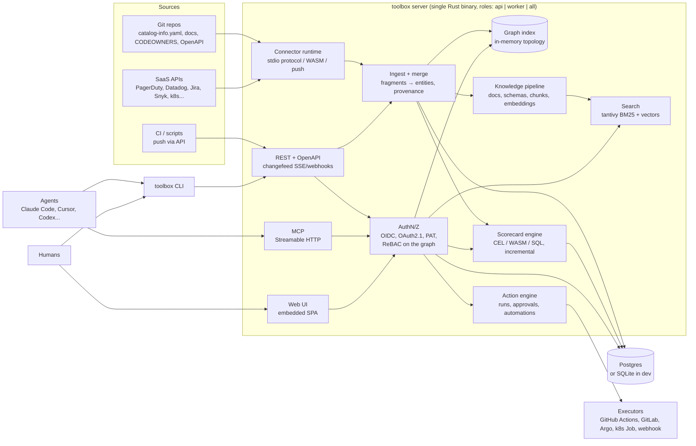

# Toolbox — Architecture & Delivery Plan

> An open-source, agent-first internal developer portal (IDP) framework. The core is written in Rust,
> it is configured entirely in code, and it is deployed by you.
> Companion document: [research.md](./research.md) (landscape, competitor analysis, validation).

---

## 1. Thesis

A Toolbox portal is a **build artifact of a git repository**. A platform team or an agent writes a
portal program **in the language they already use** (TypeScript, Python, Go, C#, Java, or plain YAML,
following the Pulumi model). The program pins a Toolbox version and declares connectors, scorecards,
actions, docs and UI views. Then they run:

```
toolbox test   →   toolbox plan   →   toolbox build   →   deploy the OCI image anywhere
```

The resulting server exposes **the same capabilities through four interfaces (API, MCP, CLI, UI)**,
generated from one definition, with one authorization model. Agents are the primary user. Humans get
the same truth through a fast, mostly read-only UI.

### Goals
1. Agents can **author** a portal: they write the config, test it, preview its effects and upgrade it,
   without bespoke knowledge.
2. Agents can **use** a portal: find, understand, assess and act on the software estate within a token
   budget, with safe side effects.
3. The portal scales to **10k+ services, 100k+ entities, 10k+ users** on boring infrastructure
   (Postgres plus stateless replicas).
4. Extensions (connectors, scorecard rules, transforms, actions, UI) can be written **in any mainstream
   language**.
5. Upgrading Toolbox is a **version bump**, not a merge of scaffolded code.
6. Operators get boring, observable operations:
   - only Postgres to back up
   - documented metric and event catalogs
   - shipped dashboards, alerts and runbooks
   - **replaceable monitoring vendors**: Grafana and PostHog are the reference backends, not
     dependencies

### Non-goals
- **Runtime configuration stored in a database.** There is no admin UI for blueprints, scorecards or
  actions. The server refuses runtime config mutation.
- A hosted SaaS, a plugin marketplace that runs arbitrary code in-process, or a drag-and-drop dashboard
  builder. Dashboards are *canvases*: agent-written code, either ephemeral drafts or promoted, reviewed
  modules ([canvases.md](./design/canvases.md)).
- Engineering-metrics analytics (DORA, surveys). Toolbox *ingests* such facts as inputs; it does not
  compete with DX-style analytics.
- Running agents. Toolbox *informs and governs* agents; runners such as Claude Code or engrams can
  trigger Toolbox actions.

### The core split: config vs. state (borrowed from Terraform)

| **Config (in git, immutable per deploy)** | **State (in Postgres, changes at runtime)** |
|---|---|
| Kinds and schemas, relation types | Entities, relations, provenance |
| Connector declarations and mappings | Connector cursors, sync status |
| Scorecards, rules, levels, initiatives, waivers | Rule outcomes, score history |
| Actions, executors, approval rules, automations | Action runs, approvals given, logs |
| Authorization model (OpenFGA DSL), derivation rules, roles | Sessions, tokens, audit log |
| UI views, navigation, branding | Search indexes, embeddings, doc renders |
| Docs sources | Docs content (re-derivable) |

Everything in the right column can be rebuilt from the sources and the left column. The only data that
cannot be rebuilt is the audit log and run history.

---

## 2. What a customer's portal repo looks like

```
acme-portal/                # a TypeScript portal; Python/Go/C#/Java/YAML repos look analogous
├── Toolbox.yaml            # project file: name, runtime (nodejs|python|go|dotnet|java|yaml), toolbox version
├── toolbox.lock            # pinned toolbox + connector/extension digests (like .terraform.lock.hcl)
├── package.json            # depends on @toolbox/sdk (+ any shared org packages)
├── src/index.ts            # the portal program: kinds, connectors, scorecards, actions, views
├── src/rules/*.ts          # optional: rule/transform functions run at runtime (see §4.6)
├── connectors/             # optional custom connectors (any language, Toolbox Connector Protocol)
├── ui/                     # optional web components (TS/JS)
├── authz/                  # OpenFGA-language model (fga.mod + modules) + .fga.yaml tests
├── docs/                   # portal-level docs, standards, skills
├── tests/                  # fixtures + expected outcomes
└── AGENTS.md               # generated by `toolbox init`: how agents should work in this repo
```

### Example: `src/index.ts`

```ts
import * as tb from "@toolbox/sdk";
import { backstageModel } from "@toolbox/backstage";        // Component, API, System, Domain, Group, User...
import { prodReadiness } from "@acme/portal-standards";      // shared org package, written in any language

const portal = new tb.Portal("acme", {
  description: "Ownership, standards and golden paths for Acme engineering",
});
const bs = backstageModel(portal);

const service = new tb.Kind("Service", {
  extends: bs.Component,
  props: {
    tier:      tb.prop.enum(["0", "1", "2", "3"], { required: true }),
    oncall:    tb.prop.string({ description: "PagerDuty schedule id" }),
    sloCount:  tb.prop.aggregate({ rel: "hasSLO", fn: "count" }),  // Port-style aggregation
    teamSlack: tb.prop.mirror("owner.spec.slack"),                 // Port-style mirror
  },
});

new tb.Connector("github", {
  package: "toolbox-dev/github@^2",                 // resolved + digest-pinned in toolbox.lock
  config: { org: "acme", token: tb.secret("env:GITHUB_TOKEN") },
  schedule: "15m", webhooks: true,
});

new tb.Connector("pagerduty", {
  package: "toolbox-dev/pagerduty@^1",
  config: { token: tb.secret("vault:kv/pd#token") },
  map: { service: { target: "'service:default/' + record.name",   // CEL mapping, evaluated in Rust
                    set: { "spec.oncall": "record.escalation_policy.id" } } },
});

prodReadiness(portal, { appliesTo: service });

new tb.Action("create-service", {
  description: "Creates a repo from the golden path, registers it, sets up CI. Use for new backend services.",
  inputs: tb.schema.object({
    name:  tb.schema.string({ pattern: "^[a-z][a-z0-9-]{2,40}$" }),
    owner: tb.schema.entityRef({ kind: bs.Group }),
    tier:  tb.schema.enum(["1", "2", "3"]),
  }),
  executor: tb.executor.template({ source: "github:acme/golden-paths//service",
                                   publish: "github:acme/{{ name }}", register: true }),
  annotations: { destructive: false, idempotent: false },
});
```

The same portal in Python:

```python
import toolbox_sdk as tb
from toolbox_backstage import backstage_model

portal = tb.Portal("acme", description="Ownership, standards and golden paths for Acme engineering")
bs = backstage_model(portal)
service = tb.Kind("Service", extends=bs.component, props={
    "tier": tb.prop.enum(["0", "1", "2", "3"], required=True),
})
tb.Scorecard("production-readiness", applies_to=service, levels=["bronze", "silver", "gold"], rules=[
    tb.Rule("has-owner", level="bronze", check="has(entity.spec.owner)"),
])
```

### How it works: the Pulumi model (decision ADR-001)

Pulumi's architecture has three parts:
- **Language hosts** (`pulumi-language-nodejs`, `-python`, `-go`, …) run the user's program with thin,
  idiomatic SDKs.
- The SDKs send `RegisterResource` calls over gRPC to the engine's **resource monitor**.
- The Go engine plans and applies. **Providers and components are plugins behind a language-neutral
  protocol**, and per-language SDKs are generated from one package schema.

Toolbox copies this split:

| Pulumi | Toolbox |
|---|---|
| Engine (Go) | Toolbox engine (Rust): validation, type-checking, plan, build |
| Language host + SDK per language | `toolbox-language-{nodejs,python,go,dotnet,java}` + `@toolbox/sdk`, `toolbox-sdk` (PyPI), Go module, NuGet, Maven |
| `RegisterResource` → resource monitor | `Register(kind\|connector\|scorecard\|action\|view…)` → **config monitor** (local gRPC/HTTP) |
| State + `pulumi preview` | Live data snapshot + `toolbox plan` (score, permission and MCP-surface diffs) |
| Pulumi Package schema → generated SDKs | **Toolbox schema** (all built-in resource types) → generated SDKs, so every language has identical features on day one |
| Multi-language components | **Portal packages**: a shared org module (e.g. `@acme/portal-standards`) written in one language and consumed from any other, via the same schema and codegen |
| Pulumi YAML | `Toolbox.yaml`-only portals: no runtime needed for simple setups |
| Automation API | The engine is also a library: `toolbox` CLI commands are callable from any SDK |

Rules that keep this safe for config as code:
- **The program runs only at build/plan time.** Its output is the canonical **Portal Manifest**
  (versioned JSON, published JSON Schema). The manifest is the real contract and what reviewers diff.
  The running server never executes the config program.
- **Determinism is enforced, not assumed.** The engine runs programs with no network by default and
  evaluates twice in CI to detect non-determinism. Secrets are references, never values.
- **Expressions stay language-neutral.** Filters, rule checks and mappings are CEL strings, so they mean
  the same thing in every SDK and evaluate in Rust at runtime at full speed. Logic that needs a real
  language becomes a runtime extension (§4.6), written in the same language as the program.
- **Why this beats a single DSL (Starlark, HCL, CUE):**
  - Developers and agents work in a language they already know, with their normal package manager,
    type checker, IDE, tests and code review.
  - Shared org standards become ordinary versioned packages.
  - Agents write idiomatic TS and Python far more reliably than niche config languages. This is the
    "meet developers where they are" point.

The costs are real:
- **SDK and codegen per language.** This is Pulumi's main ongoing investment.
- **Language-host process management** in the CLI.
- **Weaker hermeticity than Starlark.**

Mitigations:
- All SDKs are generated from one schema, and hand-written code is limited to a thin runtime.
- Ship TypeScript, Python and YAML first; Go next; C# and Java on demand.

---

## 3. System architecture



### Rust workspace (crates)

| Crate | Responsibility | Key dependencies |
|---|---|---|
| `toolbox-model` | Entity envelope, refs, kinds, relation types, JSON Schema validation, manifest IR types | serde, jsonschema |
| `toolbox-config` | Config monitor (receives `Register` calls from language hosts), language-host process management, package resolution, lockfile, manifest emission | tonic/axum |
| `toolbox-schema` + `toolbox-codegen` | The Toolbox schema for every built-in resource type; generates SDKs (TS, Python, Go, C#, Java), docs and JSON Schema | — |
| `sdk/*` (non-Rust) | Thin per-language runtimes plus generated types; language hosts | npm, PyPI, Go, NuGet, Maven |
| `toolbox-tcp` | Toolbox Connector Protocol: spec, conformance kit, Rust client/server; SDKs per language | axum, reqwest |
| `toolbox-expr` | CEL compile/eval, static field-dependency extraction, type-checking against kind schemas | cel (cel-rust) |
| `toolbox-store` | Storage traits; Postgres and SQLite implementations; migrations; outbox/changefeed; job queue (`SKIP LOCKED`) | sqlx |
| `toolbox-ingest` | Connector runtime (process protocol, push API, WASM), fragment merge, provenance, deletion semantics | tokio, wasmtime |
| `toolbox-graph` | In-memory CSR topology, traversals, impact/path queries, ownership resolution | petgraph-style custom CSR |
| `toolbox-score` | Scorecard compile, incremental evaluation, levels/points, initiatives, waivers, explain | toolbox-expr, wasmtime |
| `toolbox-actions` | Action registry, executors, run state machine, approvals, idempotency, automations, templates | minijinja, reqwest |
| `toolbox-knowledge` | Docs/schema ingest, Markdown render, chunking, embeddings, context packs | comrak, pulldown-cmark |
| `toolbox-search` | Unified index, hybrid ranking (BM25 + vectors with RRF), permission filtering | tantivy, pgvector / usearch |
| `toolbox-authz` | OIDC login, PATs, MCP OAuth 2.1 resource server; OpenFGA-compatible parser and evaluator over the catalog graph (derived tuples, facets, permission bitmaps, explain); AuthZEN endpoint; audit | openidconnect, roaring, toolbox-expr |
| `toolbox-wasm` | wasmtime host, WIT worlds, fuel/memory limits, component cache | wasmtime |
| `toolbox-api` | axum REST, OpenAPI 3.1 (generated per portal), SSE changefeed, outbound webhooks | axum, utoipa |
| `toolbox-mcp` | MCP server (Streamable HTTP + stdio bridge), tools/resources/prompts/elicitation/tasks | rmcp |
| `toolbox-ui` | Embedded SPA assets and the server side of view rendering | rust-embed |
| `toolbox-cli` | `toolbox` binary: authoring commands + remote client | clap |
| `toolbox-telemetry` | OTel setup (traces/metrics/logs), metric catalog, analytics event catalog, `AnalyticsSink` adapters (PostHog, OTLP, HTTP, file), PII scrubbing | opentelemetry, tracing |
| `toolbox-ops` | Admin API, `/mcp/ops`, health model, dashboard/alert/SLO generators (Grafana renderer first) | — |
| `toolbox-synth` | Synthetic-organization generator for benchmarks and tests | — |

A single binary runs as `toolbox serve --role all|api|worker`. Workers claim jobs from Postgres with
`FOR UPDATE SKIP LOCKED`. Schedulers use a Postgres advisory-lock leader. There is no Redis, Kafka or
Elasticsearch dependency.

---

## 4. Pillar designs

### 4.1 Catalog & knowledge graph

**Entity envelope.** Toolbox uses the Backstage envelope so `catalog-info.yaml` imports unchanged, and
adds:

```yaml
apiVersion: toolbox.dev/v1          # backstage.io/v1alpha1 also accepted
kind: Service
metadata: { name, namespace, title, description, labels, annotations, tags, links }
spec: { ... }                       # validated against the kind's JSON Schema from config
relations: [ { type, targetRef, source, confidence } ]       # derived, never authored directly
status:
  scorecards: { production-readiness: { level: silver, passed: 7, failed: 2, skipped: 1 } }
  errors: [ ... ]
provenance: { "spec.owner": { source: "git:acme/payments/catalog-info.yaml", at: "...", confidence: 1.0 } }
```

**Multi-source merge (fixes a Backstage limitation).** Connectors emit *fragments* keyed by entity
identity. The merge is a **pure, deterministic function** with these properties:
- Field-level precedence is declared in config (e.g. `owner` comes from `catalog-info` over
  `codeowners` over inference).
- Arrays and sets are canonicalized, which prevents the hash churn Backstage warns about.
- Hash-based change detection: only changed entities propagate downstream.
- Pure WASM *transforms* can run in the merge step, so it is extensible, unlike Backstage stitching.
- The ingest path never calls out to the network, following Backstage's processing-loop lesson.

**Deletion semantics.** Connectors declare `full` or `incremental` sync. After a full sync, a
`SNAPSHOT_COMPLETE` marker deletes that source's fragments that were not seen. An entity disappears
when its last fragment is gone, unless policy says to keep it as an orphan with a status flag.

**Kinds.** Default model = Backstage kinds, plus `Repository`, `Environment`, `Deployment`, `Agent`,
`MCPServer` and `Skill`/`Rule`. The last three follow Backstage's `AiResource` and `mcp-server` API type,
so the portal can catalog and distribute agent standards. Custom kinds support Port-grade expressiveness
*in code*: typed props, relations with cardinality, `mirror`, `calc` (CEL) and `aggregate` properties,
and inherited ownership.

**Graph.**
- Relations are stored in Postgres (`edges` table, both directions).
- Every replica keeps an **in-memory CSR topology**, refreshed from the changefeed. At 100k nodes and
  2M edges this is tens of MB, and it gives sub-millisecond traversals.
- Queries:
  - `neighbors(ref, types, depth)`
  - `path(a, b)`
  - `impact(ref)`: reverse-dependency closure with owners
  - `owners(ref | repo path)`: CODEOWNERS-aware
- Derived edges carry `source` and `confidence`. Examples: dependencies from SBOMs and lockfiles,
  API consumption from OpenAPI clients, and runtime calls from traces via connectors.

**Facts.** Connectors can push typed time-stamped facts (e.g. `coverage=81.2`, `open_vulns.critical=0`,
`last_deploy_at`). These follow the OpsLevel custom-event and Datadog outcome patterns. Facts are kept
as latest value plus a bounded history, and are usable by scorecard rules and views.

### 4.2 Scorecards

Shown with the Python SDK as `from toolbox_sdk import *`. Every SDK has the same shape.

```python
scorecard("production-readiness",
    applies_to = "entity.kind == 'Service' && entity.spec.lifecycle == 'production'",
    levels = [level("bronze"), level("silver"), level("gold")],        # progressive, Cortex/OpsLevel style
    rules = [
        rule("has-owner", level = "bronze", check = "has(entity.spec.owner)",
             fix = "Add `spec.owner` to catalog-info.yaml", remediation = "action:set-owner"),
        rule("has-runbook", level = "silver",
             check = "entity.metadata.links.exists(l, l.type == 'runbook')"),
        rule("oncall-configured", level = "silver",
             applies_if = "entity.spec.tier in ['0','1']",              # otherwise outcome = skip
             check = "has(entity.spec.oncall)"),
        rule("no-critical-vulns", level = "gold", check = "facts['snyk.critical'] == 0",
             stale_after = "7d"),                                      # unknown if fact is stale
        rule("sast-policy", level = "gold", check = extension("sast-policy")),  # a function in any language (§4.6)
    ],
    waivers = [waiver("service:default/legacy-billing", rule = "has-runbook",
                      until = "2027-03-31", reason = "Decommission Q1")],
)
initiative("tier1-oncall", scorecard = "production-readiness", rules = ["oncall-configured"],
           deadline = "2027-01-31", owner = "group:default/sre")  # OpsLevel campaigns / Cortex initiatives
```

- **Outcomes** are `pass | fail | skip | unknown`, with a remark. `skip` and `unknown` come from
  Datadog's outcome model and are essential for honest explanations to agents.
- **Rule languages, in tiers:**
  1. **CEL** inline: covers ~90% of rules. It is type-checked at `toolbox build` against kind schemas.
  2. **Extension functions** for complex logic, written in the program's own language. They run behind
     the Toolbox Connector Protocol's `evaluate` capability (batched over HTTP), or compile to WASM
     when the language supports it (§4.6).
  3. **SQL** (phase 5): aggregate and cross-entity checks over a read-only relational view, the
     pattern DX validated.
- **Incremental evaluation:** CEL rules are statically analysed for the fields, relations and facts
  they read. A change re-evaluates only the dependent `(rule, entity)` pairs. A scorecard config change
  triggers a full re-evaluation when the new deployment starts.
  - Target: 100 rules × 100k entities fully rescored in < 5 minutes on one worker.
- **`toolbox plan` score diff:** the killer feature for agents and reviewers. `toolbox plan --remote
  https://portal.acme.dev` uploads the new manifest (config only), and the portal evaluates it
  **server-side** against current state. No production data reaches CI, and detailed output is
  redacted to the viewer's permissions ([sdlc.md](./design/sdlc.md) §4). It reports, for example:
  "+1 rule; 214 services drop silver→bronze; 3 waivers expire before deadline".
- **Explain:** for every failing rule, return the expression, the observed values, the provenance of
  those values, the `fix` text, and a linked remediation action. This feeds MCP `explain` and the UI.

### 4.3 Self-service actions

- **Definition:**
  - name, agent-facing description, input and output JSON Schemas (Backstage Scaffolder and Port both
    use JSON-Schema inputs)
  - executor, policy, approvals (`any`/`all` of groups, Port-style), timeouts and concurrency keys
  - annotations: `read_only`, `destructive`, `idempotent`, which map 1:1 to MCP tool annotations
- **Executors:** built-in executors are listed below. All *side effects run outside the portal
  process*; the exception is sandboxed `wasm`, which has no I/O beyond host-granted HTTP.
  - `webhook` (HMAC-signed)
  - `github_workflow` (workflow_dispatch) and `gitlab_pipeline`
  - `argo_workflow` and `k8s_job`
  - `template`: MiniJinja render of a template repo, then a PR or new repo, then registration in the
    catalog
  - `pull_request`: apply a patch and open a PR
  - `wasm`: sandboxed; host-granted HTTP only
- **Runs:** a durable state machine in Postgres (`pending → awaiting_approval → running → succeeded |
  failed | cancelled`). It supports idempotency keys, logs streamed over SSE, and callbacks for external
  executors (signed run tokens).
- **Dry-run is mandatory to declare.** An action declares `dry_run = "native" | "validate_only"`. Agents
  always see what a run *would* do before doing it: the rendered template diff, the target workflow and
  inputs, and the approval path.
- **Automations:** triggers on entity events, score transitions, fact thresholds and schedules (Port
  automations), filtered with CEL. Examples: "when a tier-1 service drops below silver, open a Jira
  ticket"; "when a repo is created, run catalog bootstrap".
- **Templates/golden paths** are actions, not a separate subsystem.

### 4.4 Knowledge ("context lake"), docs and search

- **Sources:**
  - Markdown docs in repos, with `mkdocs.yml` nav honoured for TechDocs migration
  - READMEs, ADRs and runbooks
  - API specs: OpenAPI, AsyncAPI, protobuf, GraphQL SDL
  - `CODEOWNERS`, `AGENTS.md`/`CLAUDE.md`
  - incidents and postmortems, via connectors
- **Pipeline:** fetch → parse → render (Rust: comrak, GFM; Mermaid client-side) → heading-aware chunking
  → **link to entities** (repo/path ownership, annotations, explicit front-matter) → index.
- **Search:** one index for entities, doc chunks, API operations, actions and scorecard rules.
  - Uses **tantivy** (BM25, facets, fuzzy matching), plus optional vectors: pgvector in Postgres mode,
    an embedded HNSW in SQLite mode.
  - Results are fused with reciprocal-rank fusion, boosted by graph proximity to the caller's teams.
  - Permission filtering is applied before results leave the server.
  - Indexes are per replica and rebuilt from the changefeed. Snapshots can go to object storage for
    fast cold start.
- **Embeddings are optional.** Any OpenAI-compatible endpoint works, or local ONNX. With embeddings off,
  everything still works on BM25 plus the graph, which keeps self-hosting simple.
- **Context packs** (the agent-first core). `GET /v1/context/{ref}?budget=8000&for=change|incident|onboard`
  returns a token-budgeted Markdown/JSON bundle containing:
  - summary, owners and on-call
  - upstream and downstream dependencies with owners
  - owned APIs and contracts
  - scorecard gaps with fixes
  - applicable standards and skills
  - recent deploys and incidents
  - the most relevant doc excerpts, with links
  Sections are ranked and truncated to fit the budget. This is the IDP equivalent of an `AGENTS.md`
  for the whole estate.
- **Standards distribution:** `Skill` and `Rule` entities, e.g. "how we write migrations here", are
  served as MCP prompts and resources, and are filtered to the entity or repo the agent is working on.

### 4.5 Interfaces: one definition, four projections

Every capability is declared once (kind, scorecard, action, view, query) and projected:

| | API | MCP | CLI | UI |
|---|---|---|---|---|
| Catalog | `GET /v1/entities?filter=<CEL>&fields=…` | `search`, `get`, `query`, `graph` | `toolbox get/query/graph` | Catalog table, entity page, graph explorer |
| Scorecards | `GET /v1/scorecards/{id}/results` | `scorecard_status`, `explain` | `toolbox score …` | Dashboards, entity tab |
| Actions | `POST /v1/actions/{id}/runs` | `list_actions`, `describe_action`, `run_action`, `get_run` | `toolbox run …` | JSON-Schema forms, run log |
| Knowledge | `GET /v1/context/{ref}`, `/v1/docs/…` | `context`, `read_doc`; resources; prompts | `toolbox context …` | Docs reader, search |

**API**
- REST/JSON under `/v1`. The **OpenAPI 3.1 document is generated per portal at build time**, including
  typed schemas for each custom kind, so customers can generate typed clients for their own portal.
- Cursor pagination, field projection, ETags.
- Changefeed via SSE (`/v1/events`) and signed outbound webhooks.

**MCP** (rmcp; Streamable HTTP at `/mcp`; `toolbox mcp` stdio bridge for local clients)
- **Small, task-level toolset (~12 tools)**, not CRUD per resource. Per-action tools are *not*
  generated by default, so tool lists don't flood context windows. Config can promote specific actions
  to first-class tools.
- Responses are token-efficient: compact Markdown by default, JSON on request, `fields` projection,
  and hard size caps with continuation cursors.
- Tool annotations come from action metadata. Elicitation is used for missing inputs and approvals.
  Long runs use MCP tasks.
- Server `instructions` are generated from the portal description and model.
- Auth uses MCP OAuth 2.1, with Toolbox as the resource server and the customer IdP as the authorization
  server. PATs cover headless agents.

**CLI** (`toolbox`): one binary for authoring and operating.
- Authoring: `init`, `dev` (Tilt-like live reload with fixtures), `fmt`, `lint`, `test`,
  `plan [--remote URL]`, `build`, `upgrade` (codemods), `ext new rule --lang python`, `connector test`.
- Operating: `login`, `get`, `query`, `search`, `graph`, `context`, `score`, `explain`, `run`, `runs`.
- Output modes: `-o table|json|yaml|md`, stable for agents (kubectl / `tilt get` conventions).

**UI**: a TypeScript SPA embedded in the binary.
- The *exception* to "Rust everywhere", by design. Agents and humans build UI fastest in TS, and UI
  extensions must be web-native anyway.
- Entity pages and lists are generated from kind schemas and declarative `view()` config.
- Custom UI ships as **Web Components** (ES modules) built by `toolbox build` with a Rust-native
  bundler, using `@toolbox/ui-sdk` (typed API client, theme, auth).
- **The UI mostly reads.** "Edit" on git-sourced data, or on config, **opens a pull request**. Edits to
  connector-sourced data are refused with a pointer to the source.

### 4.6 Extension model: one open protocol, any language

| Need | Mechanism | Isolation | Languages |
|---|---|---|---|
| Config and reuse | Portal programs + **portal packages** (Pulumi model, §2) | Build time only | TS, Python, Go, C#, Java, YAML |
| Connectors: I/O, vendor SDKs, long-running | **Toolbox Connector Protocol (TCP)**, an open HTTP+JSON spec | Separate process, container or service; least-privilege secrets | Any language with an HTTP server. SDKs: TS, Python, Go, Rust, C#, Java |
| Runtime logic: rules, merge transforms, computed props | TCP `evaluate` capability (batched), or a **WASM component** where the toolchain is mature (Rust, Go, Python) | Process/container, or wasmtime sandbox (fuel + memory limits, no I/O) | Any (HTTP); Rust/Go/Python/JS (WASM) |
| Side-effecting actions | **Executors**: CI systems, Argo, k8s Job, PR, *or a TCP `act` capability* | Out of process | Any |
| UI | Declarative views; **Web Components** | Browser; CSP; scoped API token | TS/JS or anything compiling to JS/WASM |

#### Toolbox Connector Protocol (TCP)

TCP is a small, versioned, open spec, published separately from Toolbox. It is modelled on MCP's
shape (capability negotiation, JSON messages, transport-independent) but built for **data
synchronization**, not LLM tool calls.

- **Why not just MCP?** MCP doesn't define incremental cursors, snapshot completeness (what to delete),
  entity identity, provenance, batching or backfill. Those are exactly what connectors need. TCP
  *borrows* from MCP: an `initialize` handshake with capabilities, JSON-RPC-style errors, Streamable
  HTTP plus a stdio transport, and OAuth for remote servers. The rest is purpose-built.
- **Why not gRPC (as Terraform and Pulumi do)?** HTTP+JSON has the lowest barrier in every language:
  no protobuf toolchain, and connectors run on serverless (Lambda, Cloud Run) and behind ordinary
  ingress. The spec ships as an OpenAPI 3.1 document plus JSON Schemas, so clients and servers can be
  generated. Performance comes from streamed NDJSON bodies and batching, not from the wire format.
- **Transports:**
  - (1) **HTTP server**: Toolbox calls the connector's endpoint.
  - (2) **stdio**: Toolbox spawns the binary or container. This is the same messages as NDJSON, good
    for local dev and Airbyte-style images.
  - (3) **Push**: the connector runs anywhere (CI, cron, inside a vendor's product) and POSTs the same
    messages to `POST /v1/tcp/ingest`.
- **Capabilities**, negotiated at `initialize`; a connector implements any subset:
  - `source`: emits raw records (preferred) or pre-mapped fragments, plus relations, facts and docs.
    - Endpoints: `spec`, `check` (returns a per-kind permission verdict), `discover` (record kinds,
      each with a selector JSON Schema), `read(state, selectors) → stream of RECORD | FRAGMENT |
      RELATION | FACT | DOC | DELETE | STATE | SNAPSHOT_COMPLETE | LOG | ERROR`, `webhook(event)`.
    - **Raw records + engine-side mapping** (lesson from Port Ocean, see [ocean.md](./ocean.md)).
      Connectors emit `RECORD {kind, data}` without knowing the customer's model. The portal program
      maps records to entities with CEL (`where`, `explode`, `rel.lookup`), and connector packages
      ship overridable `defaults()`. The engine keeps a bounded raw-record store, so a mapping change
      re-maps without re-fetching, and `toolbox plan` can preview it.
    - **Engine-side reconciliation:**
      - No `SNAPSHOT_COMPLETE` or any `ERROR` in a full sync means no deletes for that kind.
      - A mass-deletion threshold applies, and deletes can be turned off per kind.
      - Unresolved relation lookups become flagged placeholder entities.
  - `evaluate`: batched rule or transform functions, e.g. `POST /evaluate {rule, entities[≤1000]} →
    outcomes[]`.
  - `act`: an action executor with `dry_run`, `run` and status callbacks. Standard fields are a
    `partition_key` (serialize runs per resource), `rate_limit` hints, async completion via webhook, and
    `identity: service | user` (on-behalf-of tokens, so an agent acting for Alice opens the PR as
    Alice).
  - `resolve`: on-demand lookups, e.g. live deploy status for an entity page. These are cached and never
    called on the ingest hot path.
- **Contract:**
  - Every record carries an entity identity, a source and a timestamp.
  - Sync mode is `full` or `incremental`. Idempotent replays are required. Schema versioning works by
    negotiation.
  - The connector's `discover` output declares what it emits, so `toolbox plan` can show it and the
    SDKs can type it.
- **Run modes:** `serve` (long-running HTTP) and `once` (cron or CI: `toolbox connector run --once
  --push <portal>`), so a connector can feed a portal with no extra infrastructure.
- **Tooling:**
  - **Conformance test kit** (`toolbox connector test`): replays recorded fixtures and checks ordering,
    idempotency and deletion semantics.
  - A first-party **declarative HTTP connector** (OpenAPI-aware endpoints, auth and pagination) for
    internal systems that need no code.
  - A connector-authoring agent skill plus `toolbox connector new`.
  - SDK helpers for webhook processing (authenticate → validate → handle, retries) and incremental
    strategies (server-side `since` vs. client-side early stop).
  - Spike: an **Ocean compatibility runner** that executes unmodified Port Ocean integrations as TCP
    sources (see [ocean.md](./ocean.md) §4).
  - SDKs that reduce a connector to a few typed handlers.
  - Connector packages are distributed through standard registries (npm, PyPI, Go modules, OCI) and
    pinned in `toolbox.lock`.
- **Dogfood:** every first-party connector uses TCP, with no private in-process path. First-party
  connectors: GitHub, GitLab, Bitbucket, Kubernetes, Argo CD, PagerDuty, Opsgenie, Datadog, Prometheus,
  Jira, Linear, Snyk, SonarQube, Okta/Entra/Google (org data), Backstage (import), and an
  OpenAPI/SBOM scanner.
- **Standardization path:** first a spec with versioning and a conformance suite. Pursue a neutral home,
  e.g. a foundation, only once third parties implement it. A standard is earned by adoption, not
  declared.

---

### 4.7 Product capabilities (detailed designs)

These designs close the gaps found in the [red-team review](./red-team.md). Each has its own document:

| Capability | Summary | Design |
|---|---|---|
| **Meta catalog** | The portal's kinds, connectors, scorecards, rules, actions, canvases, authz modules and packages are owned catalog entities, with a dependency graph and default scorecards (ownership, connector health, scorecard quality, …). The portal scores itself, including the scorecards that score scorecards | [meta-catalog.md](./design/meta-catalog.md) |
| **Canvases** (dashboards) | Agent-generated interactive views in the Cursor Canvas / Claude Artifacts style: TSX over a typed, permission-scoped data bridge in a sandboxed iframe. Drafts are ephemeral; promoted canvases are code. Includes a score/fact history store and scheduled reports | [canvases.md](./design/canvases.md) |
| **Identity resolution** | External ids, declared matchers, structural inference, unmatched/ambiguous/conflict states, PR-based link proposals, aliases for renames, merges and splits | [identity-resolution.md](./design/identity-resolution.md) |
| **Notifications + GitHub** | Ownership-routed events; GitHub App with living dashboard issue, PR score-delta checks, fix PRs and initiative issues; email; CloudEvents webhooks; GitHub Actions for service repos (validate, push, scorecard-check, context, run-action). Slack is out of scope for now | [notifications.md](./design/notifications.md) |
| **Portal SDLC** | Local → CI → PR → ephemeral preview → prod. **Remote plan** (no prod data in CI, output redacted per viewer), policy gates (deletion, authz loss, operator lock-out, notification volume), signed + attested builds, verify + rollback, GitHub Actions + reusable workflow | [sdlc.md](./design/sdlc.md) |
| **Action-created entities** | Action scopes (`create`/`day2`/`delete`/`global`), action-sourced fragments, TTL lifecycles with expiry automations, pending overlays for PR-based changes, bulk-edit PRs | [action-entities.md](./design/action-entities.md) |

## 5. Security model

- **One policy enforcement point** for API, MCP, CLI and UI. Backstage's MCP registry leaves permission
  checks to each action; Toolbox does not.
- **AuthN:** OIDC SSO for humans; MCP OAuth 2.1 for agents acting on behalf of a user; scoped PATs and
  service tokens for CI.
  - Agent principals are first-class. Every audit entry records the agent *and* the human it acts for.
- **AuthZ: relationship-based access control on the catalog graph.** Full design in
  [authorization.md](./authorization.md).
  - The model is written in the OpenFGA language (CEL conditions, modular models).
  - Tuples are *derived* from catalog relations by rules in code, so there is no separate permission
    store and no sync.
  - It is evaluated in-process in Rust, with OpenFGA's conformance corpus and the stock `fga` CLI as
    test oracles.
  - **Facets** give field-level visibility: e.g. a scorecard summary is visible to all, its details
    only to the owning team.
  - One response-shaping layer enforces this for API, MCP, CLI, UI, search, context packs and the
    changefeed.
  - `.fga.yaml` model tests, catalog-fixture derivation tests and surface snapshot tests all run in
    `toolbox test`. `toolbox plan` reports authorization impact, e.g. who gains or loses which
    permission.
  - An AuthZEN 1.0 endpoint and an optional external OpenFGA mode keep the decision engine
    replaceable.
- **Secrets** are never in config; config holds only references (`env:`, `vault:`, `aws-sm:`,
  `gcp-sm:`, `k8s:`). WASM gets no secrets.
- **Untrusted content:** doc and README text returned to agents is wrapped and labelled as untrusted
  data, to resist prompt injection. Actions marked `destructive` require explicit confirmation via
  elicitation or approval.
- Append-only audit log, rate limits, signed webhooks, SBOM and provenance for releases.

---

## 6. Operator experience

Operators are the people (and increasingly the SRE agents) who install, run, upgrade, monitor and recover
a portal. They are a different audience from portal authors and portal users, and they get first-class
treatment: every operational concern has a documented interface, and every monitoring vendor is
replaceable.

### 6.1 Three kinds of configuration, three owners

| Layer | Owned by | Where | Examples | Rule |
|---|---|---|---|---|
| **Portal behaviour** | Portal authors | Portal program (build time) | Kinds, scorecards, actions, connectors, policies, *which* telemetry sinks exist | All behaviour is here, reviewed in PRs |
| **Environment binding** | Operators | Env vars / Helm values / Terraform (deploy time) | DB URL, replicas, OTLP endpoint, PostHog host and key, log level, sink on/off | Can only **bind or disable** what the program declared, never add behaviour. The same image runs in staging and prod. |
| **State** | The system | Postgres | Entities, runs, audit, cursors | Backed up, never hand-edited |

`toolbox admin config` prints the effective configuration, with secrets redacted and the source of
each value (program, env or default). "Why is it doing that?" is answerable in one command.

### 6.2 Deploy, upgrade, recover

- **Artifact:** `toolbox build` produces an OCI image: `FROM ghcr.io/toolbox-dev/toolbox:<pinned>` plus
  the manifest bundle (evaluated IR, WASM components, UI assets, generated OpenAPI). Config is immutable
  per image, and rollback = deploy the previous image.
- **Targets:** a Helm chart, docker-compose, and Terraform modules for ECS, Cloud Run and Fly. Anything
  that runs a container works. Reference sizes:
  - *small*: 1 container + Postgres, up to ~5k entities
  - *medium*: 2 API + 1 worker
  - *large*: 3+ API, N workers, read replica
- **Dependencies:**
  - **Postgres ≥ 15** for production (pgvector optional).
  - **SQLite** for `toolbox dev` and small single-node installs.
  - Object storage optional (doc assets, index snapshots).
  - No other required services.
- **Scale-out:** stateless API replicas plus N workers. The graph and search indexes are local per
  replica, fed by the changefeed, and readiness waits for catch-up.
- **Database migrations:** expand/contract only, so rolling deploys are always safe across N → N+1.
  - `toolbox admin migrate plan` shows the SQL and the expected lock impact.
  - Migrations run as a Helm pre-upgrade job or on leader start-up; the operator chooses.
- **Upgrades:** SemVer. The manifest IR is versioned with migrations, `toolbox lint` warns on
  deprecations, and `toolbox upgrade` applies SDK codemods (TS/Python first). LTS lines start at 1.0.
  Release notes are machine-readable, so upgrade agents can act on them.
- **Backup and DR:**
  - **Only Postgres needs backing up.** Search indexes, the graph, doc renders and embeddings are
    rebuildable.
  - RPO = Postgres RPO. RTO is bounded by re-indexing, which is shortened by index snapshots in object
    storage.
  - `toolbox admin backup verify` restores into a scratch database and checks invariants. A DR drill is
    part of the v1.0 exit criteria.
- **Retention** (in code, per data type): raw connector records, run logs, analytics events and audit,
  each with its own window. Defaults are conservative and documented.

### 6.3 Observability: replaceable by design

Toolbox emits three different kinds of telemetry. Each goes through a **vendor-neutral boundary**, and
each has a **reference backend**:

| Signal | Questions it answers | Neutral boundary | Reference backend | Swap for |
|---|---|---|---|---|
| **Operational**: traces, metrics, logs | Is it up? Is it fast? Are connectors lagging? | **OpenTelemetry (OTLP)** with documented semantic conventions; also a Prometheus `/metrics` endpoint and JSON logs on stdout | **Grafana** (Prometheus/Mimir, Loki, Tempo via an OTel Collector or Alloy) | Datadog, Honeycomb, New Relic, Elastic, CloudWatch: anything that speaks OTLP or scrapes Prometheus |
| **Product analytics**: usage events | Who uses the portal, humans vs. which agents? Which MCP tools succeed? Where do searches return nothing? Which actions get abandoned? | Toolbox's own **versioned event catalog**, delivered through an `AnalyticsSink` | **PostHog** | Any sink adapter: OTLP log events, generic HTTP/NDJSON webhook, file/stdout, or `none` |
| **Audit**: security record | Who did what, on whose behalf? | Append-only table in Postgres; export stream | (internal) | Any SIEM, via webhook or OTLP logs export |

Audit is deliberately **not** analytics. It is never sampled, never routed to an analytics vendor, and
has its own retention.

**Operational telemetry (Grafana as reference, OTel as contract)**
- All crates instrument with `tracing` and export via OpenTelemetry. Trace context propagates through
  API, MCP and CLI calls, connector protocol requests, and action executors, so one trace can follow
  an agent's `run_action` all the way into the GitHub workflow callback.
- A **metric catalog** is part of the public, SemVer-covered surface: names, units and labels are
  documented and stable. Examples:
  - `toolbox_connector_lag_seconds{connector,kind}`
  - `toolbox_ingest_records_total`
  - `toolbox_scoring_backlog`
  - `toolbox_mcp_tool_calls_total{tool,client,outcome}`
  - `toolbox_action_runs_total{action,state}`
  - `toolbox_index_freshness_seconds{index}`
- Toolbox ships the Grafana pack as code, in an **optional** package (`@toolbox/grafana`, `toolbox ops
  export grafana`). It contains:
  - Dashboards (overview, connectors, scoring, actions, MCP/agents, Postgres) generated with Grafana's
    Foundation SDK.
  - **Alert rules in Prometheus rule format.** These work in Prometheus, Mimir, Grafana-managed
    alerting and other PromQL-compatible backends.
  - SLO definitions (§6.5) compiled to recording and alerting rules.
  - Each alert links to a runbook in the docs.
- Replacing Grafana loses only the dashboards, because metrics, traces, logs and alert rules are
  portable. Dashboards are generated from an internal, backend-neutral panel spec, so a renderer for
  another tool (e.g. Perses, the CNCF dashboards-as-code project) can be added without touching the
  core.

**Product analytics (PostHog as reference, event catalog as contract)**
- **Event catalog:** a versioned schema of ~30 events, published in the docs and covered by SemVer.
  Every event carries `actor_type` (`human | agent | service`), the `client` (MCP `clientInfo`, CLI,
  UI) and a pseudonymous `actor_id`. Examples:

  | Event | Key properties |
  |---|---|
  | `search.performed` | surface, result_count, zero_results, latency_ms |
  | `mcp.tool.called` | tool, client, outcome, latency_ms, response_tokens |
  | `context.pack.served` | budget, used_tokens, sections, for |
  | `entity.viewed` | kind, surface |
  | `scorecard.explained` | scorecard, rule_count_failing |
  | `action.run.transitioned` | action, from, to, dry_run, identity |
  | `pr.proposed` | origin (ui \| mcp), target |

  The agent-specific events give a rare view of *agent experience*: which tools agents pick, how often
  they fail, and how many tokens the portal costs them.
- **Single pipeline:** UI events go to the Toolbox server (`POST /v1/analytics`) instead of loading a
  vendor script in the browser. Server events and UI events then share one schema, one PII scrubber and
  one sink switch.
- **`AnalyticsSink` adapters** are compiled into the binary:
  - `posthog`: batched capture API. Toolbox Groups map to PostHog group analytics, so usage rolls up
    by team.
  - `otlp`: events as OTel log records.
  - `http`: signed NDJSON to any receiver, written in any language.
  - `file`
  - `none`
- **Privacy defaults:**
  - Actor ids are HMAC-pseudonymized with a deploy-time key.
  - No entity content, search text or doc text is sent unless the program opts in per event field.
  - Self-hosted PostHog is supported, and there is one kill switch (`TOOLBOX_ANALYTICS=off`).
- **Kept out on purpose:**
  - **PostHog feature flags and experiments are not used to change portal behaviour**, because that
    would move configuration out of code.
  - PostHog session replay is an opt-in UI plugin, off by default, with inputs masked.

### 6.4 Telemetry in the portal program

```ts
new tb.Telemetry("default", {
  otel: tb.otel.otlp({ endpoint: tb.env("OTEL_EXPORTER_OTLP_ENDPOINT") }),   // standard OTel env vars also honoured
  metrics: { prometheus: true },                                           // /metrics on the admin port
  analytics: [
    tb.analytics.posthog({ host: tb.env("POSTHOG_HOST"), key: tb.secret("env:POSTHOG_KEY"),
                           groups: { team: "owner" } }),
    // tb.analytics.http({ url: tb.env("ANALYTICS_WEBHOOK") }),            // swap or fan out
  ],
  analyticsFields: { "search.performed": { includeQueryText: false } },
  retention: { analytics: "90d", runLogs: "30d", rawRecords: "14d", audit: "400d" },
});
```

The operator binds endpoints and keys per environment and can disable any sink with an env var. The
program decides what exists.

### 6.5 Day-2 operations

- **Self-observation in the product:** a *Portal health* page (UI) and `toolbox admin status` (CLI)
  show:
  - connector status and lag per kind, with the last error and permission-probe verdicts
  - queue depths, scoring backlog, index freshness
  - migration state, version skew between replicas
  - dead-lettered webhooks
- **Admin commands** are remote, policy-gated (`operator` relation on `portal`) and audited:
  - `resync <connector> [--kind]`, `replay --dead-letter`
  - `reindex search|graph`, `rescore [--scorecard]`
  - `drain` (stop workers for maintenance)
  - `migrate status|plan|apply`
  - `backup verify`, `export audit`
- **Agent operators:** the same admin operations are exposed on a separate MCP endpoint (`/mcp/ops`),
  available only to operator principals. An SRE agent can diagnose and remediate the portal itself,
  for example: "connector X is lagging because of 403s, the token lost the `repo` scope".
- **Built-in SLOs** (defaults in code, adjustable):
  - API availability and latency
  - connector freshness (`connector_lag < 15m`)
  - scoring freshness
  - action-run success
  - MCP tool success rate
  These compile to the alert rules in §6.3.
- **Runbooks** ship with the docs, one per alert. Each has symptoms, a diagnosis command, a fix and an
  escalation path.

### 6.6 Scale targets (v1.0 SLOs, verified in CI by `toolbox-synth`)

| Dimension | Target |
|---|---|
| Entities / relations | 100k / 2M |
| Users / teams | 10k / 1k |
| Scorecards × rules | 50 × 100 |
| Doc chunks | 1M |
| Read API p99 (get/query/search) | < 200 ms at 500 RPS on 3 replicas |
| Webhook → visible in API | < 60 s p95 |
| Full rescore (100 rules × 100k entities) | < 5 min |
| Cold start to ready (index snapshot present) | < 60 s |

---

## 7. Agent authoring experience

This is a stated product goal, so it is a **tested requirement**:

- `toolbox init` scaffolds the portal repo with `AGENTS.md`, Agent Skills for "add a kind", "add a
  scorecard", "add a connector" and "add an action", a JSON Schema for the manifest, and examples.
- `toolbox mcp --dev` is an *authoring* MCP server for coding agents. Its tools are `validate`,
  `plan`, `test`, `explain_error`, `docs_search` and `example`.
- Every error carries a stable code, the location, and a suggested fix.
- `llms.txt` and the full docs ship inside the binary (`toolbox docs <topic>`).
- **Agent eval suite in CI:** ~50 scripted authoring tasks are run against Claude Code and other agents
  on each release, tracking success rate, retries and tokens. Examples: "require SLOs for tier-1
  services", "ingest Opsgenie on-call", "add a create-postgres action with approval by DBAs". A
  regression blocks the release.
- An MCP tool-surface snapshot test (`tests/mcp_tools.snap`) makes changes to the agent-facing
  interface show up in PR review.

---

## 8. Delivery roadmap

Timelines assume 3–5 engineers working heavily with agents. Each phase ends with a demo and exit criteria.

### Phase 0 — Foundations & spikes (weeks 0–4)
- ADRs:
  - 001 Pulumi-style multi-language programs + manifest IR
  - 002 CEL
  - 003 Postgres/SQLite
  - 004 extension tiers
  - 005 TS UI with Web Components
  - 006 license (recommend **Apache-2.0** so it works as a dependency in any company)
- Spikes:
  - Toolbox schema → generated TS and Python SDKs; config monitor; nodejs and python language hosts;
    typed manifest emission and a determinism check
  - CEL conformance and static field-dependency extraction
  - a wasmtime rule component authored in Rust, Python and TS
  - Postgres with 100k synthetic entities (merge throughput, graph load, query plans)
  - rmcp Streamable HTTP with OAuth
- `toolbox-synth` generator; CI with benchmarks.
- **Exit:** go/no-go on the language-host model, CEL, TCP-over-HTTP and WASM, with numbers.
- Draft TCP spec v0 (OpenAPI + JSON Schemas) and conformance kit skeleton.

### Phase 1 — Catalog core (weeks 4–14) → `v0.1`
- `toolbox-model`, `-config`, `-store`, `-ingest`, `-graph`, `-api`, `-cli`, `-authz` (OIDC, PAT; OpenFGA-compatible Check/ListObjects over derived tuples; facets and response shaping; Level 1–2 authz tests).
- Connectors: `git-files` (catalog-info.yaml incl. Backstage format), GitHub (repos, CODEOWNERS,
  webhooks), Backstage import, generic push API.
- MCP read tools: `search` (Postgres FTS initially), `get`, `query`, `graph`.
- Minimal UI: catalog, entity page, graph view, login.
- Operations baseline:
  - OTel traces, metrics and logs; `/metrics`; health and readiness endpoints.
  - Analytics event catalog v0 with the `posthog`, `otlp` and `none` sinks.
  - `toolbox admin status|config|resync`; Grafana overview and connector dashboards.
- `toolbox init/dev/lint/test/build`. Helm chart and Docker image.
- **Meta catalog v1:** meta kinds derived from the manifest; required owners with resolution order;
  `ownership` scorecard (bronze/silver); the portal cataloged as a system.
- **Identity resolution v1:** external ids, annotation translation, declared matchers,
  unmatched/conflict states, aliases on rename.
- **Notifications v1:** event model, ownership routing, inbox, email, shadow mode.
- **SDLC v1:** `setup-toolbox`/`test`/`build`/`verify` Actions; signed and attested images; service-repo
  Actions `validate-catalog` and `push` with GitHub OIDC.
- **Exit:** import the Backstage demo catalog plus a 50k-entity synthetic org. An agent answers
  "who owns X, what depends on Y, who do I page" via MCP, with correct permissions.

### Phase 2 — Scorecards (weeks 14–22) → `v0.2`
- CEL rules, levels and points, `skip`/`unknown`, waivers, initiatives, facts ingestion.
- Incremental evaluator; `explain`.
- **Remote plan** service and planner principal; `plan` Action with sticky comment, gates
  (deletion, authz loss, operator access, notification volume) and detailed plan pages. Production data
  never goes to CI.
- Extension rules via TCP `evaluate` (TS and Python SDKs) and a WASM path for Rust; `toolbox ext new`.
- **Canvases v1:** history store (score/fact/catalog daily), `@toolbox/canvas` components, promoted
  canvases in slots, built-in scorecard/ownership/portal-health canvases, snapshot tests.
- **Meta scorecards:** `scorecard-quality`, `connector-health`, `kind-quality`; `RuleResult` virtual
  kind; routing of `unknown` outcomes to connector owners.
- **GitHub App:** living dashboard issue, PR score-delta check runs (`scorecard-check` Action).
- Identity proposals queue + PR-based resolution; coverage metrics.
- MCP `scorecard_status` and `explain`; score-transition events.
- **Exit:** 100 rules × 100k entities rescored in < 5 min. A remote-plan diff (redacted aggregates)
  is shown as a PR comment, and a team's living dashboard issue updates on a score transition.

### Phase 3 — Actions (weeks 22–32) → `v0.3`
- Action registry, run state machine, approvals, idempotency, dry-run.
- Executors: webhook, GitHub workflow, GitLab pipeline, k8s Job, template + PR.
- Automations (entity, score and schedule triggers).
- **Action scopes** (`create`/`day2`/`delete`/`global`), action-sourced fragments, TTL lifecycle
  engine, pending overlays, bulk-edit PRs.
- **Canvas drafts** via MCP (`canvas_create/preview/promote`), `ActionButton`.
- **Preview environments** (compose, k8s) with GitHub Deployments and GC; ownership-aware review.
- Fix PRs, initiative tracking issues, approvals via GitHub Environments, `run-action` Action;
  `action-quality` scorecard and Rule day-2 actions (waiver, false positive).
- MCP `list_actions`/`describe_action`/`run_action`/`get_run` with elicitation and tasks. UI forms and
  run logs.
- **Exit:** an agent creates a service from a golden path end to end, with approval, audit and catalog
  registration, and no human UI needed.

### Phase 4 — Knowledge & search (weeks 32–42) → `v0.4`
- Docs pipeline (Markdown, mkdocs nav, OpenAPI/AsyncAPI/proto), entity linking.
- tantivy hybrid search, optional embeddings, permission-filtered results.
- Context packs; `Skill`/`Rule` distribution as MCP prompts and resources; docs reader UI.
- Scheduled canvas reports (per-recipient rendering), shared links, design-mode feedback;
  `context` Action for AI review agents; CloudEvents webhook channel.
- Redacted production sample for previews; `upgrade --check` PRs; remaining meta scorecards
  (`canvas-quality`, `authz-quality`, `package-hygiene`), contribution-based ownership facts.
- **Exit:** a context-pack benchmark. On a fixed set of change/incident/onboarding tasks, agents with
  `context` beat agents without it on success rate at an equal token budget.

### Phase 5 — Ecosystem (weeks 42–52) → `v0.5`
- Connector SDKs (Python, TS, Go, Rust) and the first-party connector set (§4.6).
- UI SDK and Web Components; portal packages (multi-language sharing via schema and codegen); Go SDK, then C# and Java.
- SQL rules over a read-only relational view.
- Importers from Backstage (full), Port (blueprints, scorecards, actions → TS or Python program) and Cortex
  (scorecard YAML → TS or Python program).
- Terraform modules for ECS and Cloud Run.

### Phase 6 — Hardening → `v1.0` (≈ months 12–15)
- Full operator pack: all dashboards, SLO alert rules, a runbook per alert, `/mcp/ops`, the backup-verify
  command, and a DR drill.
- Metric and event catalogs frozen under SemVer.
- Meet the SLOs in §6.6. HA and chaos tests, security review and fuzzing (manifest/CEL/TCP/WASM inputs),
  upgrade codemods, docs site, LTS policy.
- Reference deployment: a portal configured entirely in a public repo (dogfooding: the project's own
  portal, including its meta catalog). Demos are explicitly deferred.

---

## 9. Risks & mitigations

| Risk | Mitigation |
|---|---|
| Backstage ecosystem gravity (250+ plugins) | Read `catalog-info.yaml` unchanged; a Backstage importer; possibly a Backstage plugin that reads Toolbox data, so both can coexist during migration |
| Non-engineers can't edit config | UI and MCP "propose change" opens PRs; agents do the editing; `plan` makes review easy |
| Per-language SDK maintenance (Pulumi's biggest ongoing cost) | Generate SDKs from one schema; thin hand-written runtimes; TS, Python and YAML first; the manifest IR is the stable contract |
| Non-deterministic config programs | Build-time only; no network by default; double-evaluation check in CI; the manifest is the reviewed artifact |
| TCP fails to attract third-party implementers | Dogfood it for all first-party connectors; keep it small; conformance kit; also accept Airbyte-style stdio images |
| WASM tooling uneven across languages (JS `componentize` still experimental) | WASM is optional; the process protocol and executors cover every language; support Rust/Python/TS first |
| MCP spec churn (deprecations under way, e.g. sampling) | Use the official rmcp SDK, isolated in `toolbox-mcp`; avoid deprecated primitives |
| Static config needs a redeploy for any change | Fast builds (< 1 min), cheap rollouts, `toolbox dev` for iteration. This is by design, as with Terraform |
| Building a correct ReBAC evaluator | OpenFGA's Apache-2.0 conformance corpus on every build; nightly differential fuzzing against real OpenFGA; stock `fga model test` as an oracle in portal CI (see authorization.md §7) |
| Lock-in to monitoring vendors (PostHog, Grafana) | OTLP + Prometheus formats as the contract; analytics via a versioned event catalog and pluggable sinks; dashboards generated from a neutral spec; vendor packs are optional |
| Feature breadth of funded vendors | Compete on agent surface, dev loop (`plan`/`test`) and ownership. Don't build analytics |
| Adjacent OSS entrants (Frontkeep, OpsCat, Lekton) | Differentiate on config as code + catalog/scorecard depth + Backstage compatibility; collaborate where interfaces overlap (e.g. MCPServer/Skill kinds) |
| Name collision: "Toolbox" is generic, and other MCP-related projects use it | Check trademark and package namespaces (crates.io, npm, ghcr) in phase 0 |

---

## 10. Open decisions for the maintainer

1. **Launch languages:** TypeScript + Python + YAML (recommended), with Go next? Every SDK is generated
   from the same schema, so this only sets order and test burden.
2. **TCP governance:** publish it as a separate spec repo under a neutral name from day one
   (recommended), or keep it inside Toolbox until it stabilises?
3. **UI stack:** TS SPA plus Web Components (recommended), or an all-Rust UI (Leptos), which is more
   consistent but has a weaker extension story?
4. **License:** Apache-2.0 (recommended) vs. MPL-2.0 vs. AGPL (protects against hosting forks but deters
   adoption as a dependency).
5. **Expression language:** CEL everywhere (recommended), or also support JQ mappings for Port Ocean
   familiarity?
6. **Scope of v0.1 connectors:** GitHub-first, or GitHub and GitLab together?
