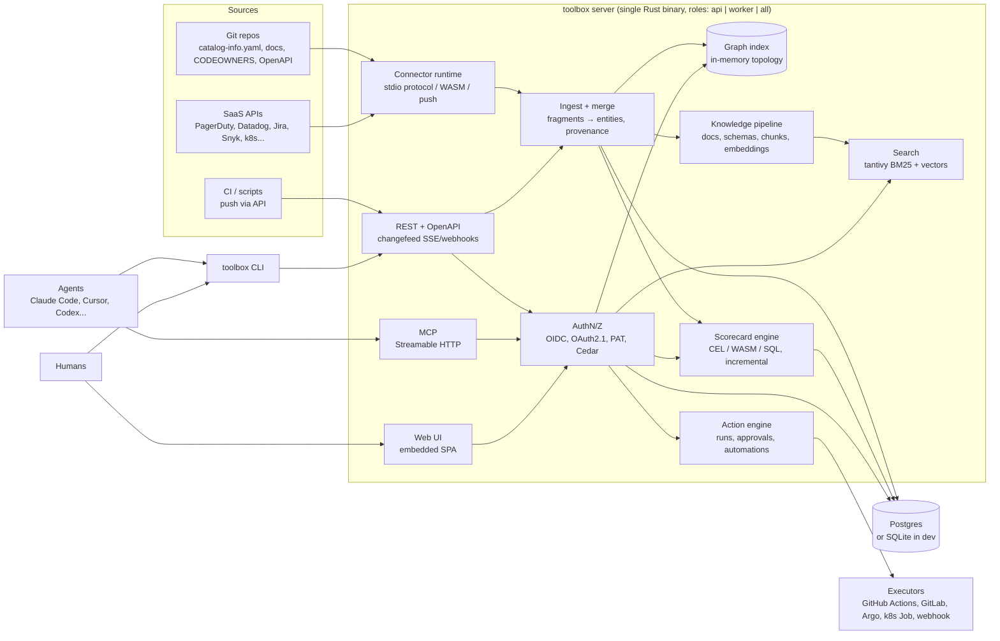

# Toolbox — Architecture & Delivery Plan

> An open-source, agent-first internal developer portal (IDP) framework. The core is written in Rust,
> it is configured entirely in code, and it is deployed by you.
> Companion document: [research.md](./research.md) (landscape, competitor analysis, validation).

---

## 1. Thesis

A Toolbox portal is a **build artifact of a git repository**. A platform team or an agent writes a
`toolbox.star` config, pins a Toolbox version, adds connectors, scorecards, actions, docs and UI views,
and runs:

```
toolbox test   →   toolbox plan   →   toolbox build   →   deploy the OCI image anywhere
```

The resulting server exposes **the same capabilities through four interfaces (API, MCP, CLI, UI)**,
generated from one definition, with one authorization model. Agents are the primary user. Humans get
the same truth through a fast, mostly read-only UI.

### Goals
1. Agents can **author** a portal: they write the config, test it, preview its effects and upgrade it,
   without bespoke knowledge.
2. Agents can **use** a portal: find, understand, assess and act on the software estate within a token
   budget, with safe side effects.
3. The portal scales to **10k+ services, 100k+ entities, 10k+ users** on boring infrastructure
   (Postgres plus stateless replicas).
4. Extensions (connectors, scorecard rules, transforms, actions, UI) can be written **in any mainstream
   language**.
5. Upgrading Toolbox is a **version bump**, not a merge of scaffolded code.

### Non-goals
- **Runtime configuration stored in a database.** There is no admin UI for blueprints, scorecards or
  actions. The server refuses runtime config mutation.
- A hosted SaaS, a plugin marketplace that runs arbitrary code in-process, or a drag-and-drop dashboard
  builder.
- Engineering-metrics analytics (DORA, surveys). Toolbox *ingests* such facts as inputs; it does not
  compete with DX-style analytics.
- Running agents. Toolbox *informs and governs* agents; runners such as Claude Code or engrams can
  trigger Toolbox actions.

### The core split: config vs. state (borrowed from Terraform)

| **Config (in git, immutable per deploy)** | **State (in Postgres, changes at runtime)** |
|---|---|
| Kinds and schemas, relation types | Entities, relations, provenance |
| Connector declarations and mappings | Connector cursors, sync status |
| Scorecards, rules, levels, initiatives, waivers | Rule outcomes, score history |
| Actions, executors, approval rules, automations | Action runs, approvals given, logs |
| Policies (Cedar), roles | Sessions, tokens, audit log |
| UI views, navigation, branding | Search indexes, embeddings, doc renders |
| Docs sources | Docs content (re-derivable) |

Everything in the right column can be rebuilt from the sources and the left column. The only data that
cannot be rebuilt is the audit log and run history.

---

## 2. What a customer's portal repo looks like

```
acme-portal/
├── toolbox.star            # entrypoint (Starlark), like a Tiltfile
├── toolbox.lock            # pinned toolbox version + connector/extension digests (like .terraform.lock.hcl)
├── model/kinds.star        # custom kinds, props, relations
├── scorecards/*.star
├── actions/*.star
├── connectors/             # connector config; optional custom connectors (any language)
├── extensions/             # WASM components: rules/transforms (Rust/Go/Python/TS sources + build)
├── ui/                     # declarative views (.star) + optional web components (TS/JS)
├── policies/*.cedar        # authorization as code
├── docs/                   # portal-level docs, standards, skills
├── tests/                  # fixtures + expected outcomes
└── AGENTS.md               # generated by `toolbox init`: how agents should work in this repo
```

### Example: `toolbox.star`

```python
load("@toolbox//std", "kind", "prop", "rel", "connector", "secret", "every",
     "scorecard", "level", "rule", "action", "executor", "schema", "view")
load("@toolbox//backstage", "backstage_model")   # Component, API, System, Domain, Resource, Group, User
load("./scorecards/prod_readiness.star", "prod_readiness")

toolbox(version = "~> 0.4", name = "Acme Portal",
        description = "Ownership, standards and golden paths for Acme engineering")

backstage_model()

kind("Service", extends = "Component",
     props = {
         "tier":   prop.enum(["0", "1", "2", "3"], required = True),
         "oncall": prop.string(description = "PagerDuty schedule id"),
         "slo_count": prop.aggregate(rel = "hasSLO", fn = "count"),     # Port-style aggregation
         "team_slack": prop.mirror("owner.spec.slack"),                 # Port-style mirror
     })

connector("github", image = "ghcr.io/toolbox-dev/connector-github",  # digest pinned in toolbox.lock
          config = {"org": "acme", "token": secret("env:GITHUB_TOKEN")},
          schedule = every("15m"), webhooks = True,
          emits = ["Repository", "catalog-info", "codeowners", "facts:github"])

connector("pagerduty", image = "ghcr.io/toolbox-dev/connector-pagerduty",
          config = {"token": secret("vault:kv/pd#token")},
          map = {   # CEL mapping from raw records to entity fragments (Ocean/JQ-style, but CEL)
              "service": {"target": "'service:default/' + record.name",
                          "set": {"spec.oncall": "record.escalation_policy.id"}},
          })

prod_readiness()

action("create-service",
       title = "Create a new service from the golden path",
       description = "Creates a repo from the template, registers it, sets up CI. Use for new backend services.",
       inputs = schema.object({
           "name":  schema.string(pattern = "^[a-z][a-z0-9-]{2,40}$"),
           "owner": schema.entity_ref(kind = "Group"),
           "tier":  schema.enum(["1", "2", "3"]),
       }),
       executor = executor.template(source = "github:acme/golden-paths//service",
                                    publish = "github:acme/{{ name }}", register = True),
       annotations = {"destructive": False, "idempotent": False},
       policy = "permit if principal in owner")  # sugar compiled to Cedar
```

`toolbox.star` is evaluated **at build time** (hermetic: no network, no clock, no randomness). The
result is a canonical **Portal Manifest**: versioned JSON validated by a published JSON Schema. The
manifest is the real contract. Starlark is the first-party authoring layer. Hand-written YAML/JSON
manifests and future TypeScript/Python SDKs (Grafana Foundation-SDK style) emit the same IR.

### Why Starlark (decision ADR-001)
- **Agent fluency:** it is Python syntax, which LLMs write well, unlike HCL, CUE, Pkl or Nickel.
- **Hermetic and deterministic:** no I/O and bounded execution, so `plan` is reproducible and safe to
  run in CI on untrusted PRs.
- **Rust-native:** `starlark-rust` (Meta, used by Buck2) embeds with no extra runtime, and has an LSP
  and a debugger.
- **Precedent:** Tilt (the requested inspiration), Bazel and Buck2. Reuse comes from `load()` of modules
  from git refs (`load("@github.com/acme/portal-modules//security.star@v1.2", ...)`), pinned in the lock.
- **Risk:** starlark-rust makes no API-stability promise. Mitigation: wrap it in `toolbox-config`, pin
  it, and own the stdlib surface.

---

## 3. System architecture



### Rust workspace (crates)

| Crate | Responsibility | Key dependencies |
|---|---|---|
| `toolbox-model` | Entity envelope, refs, kinds, relation types, JSON Schema validation, manifest IR types | serde, jsonschema |
| `toolbox-config` | Starlark evaluator, stdlib, `load()` resolution, lockfile, manifest emission, LSP stubs | starlark-rust |
| `toolbox-expr` | CEL compile/eval, static field-dependency extraction, type-checking against kind schemas | cel (cel-rust) |
| `toolbox-store` | Storage traits; Postgres and SQLite implementations; migrations; outbox/changefeed; job queue (`SKIP LOCKED`) | sqlx |
| `toolbox-ingest` | Connector runtime (process protocol, push API, WASM), fragment merge, provenance, deletion semantics | tokio, wasmtime |
| `toolbox-graph` | In-memory CSR topology, traversals, impact/path queries, ownership resolution | petgraph-style custom CSR |
| `toolbox-score` | Scorecard compile, incremental evaluation, levels/points, initiatives, waivers, explain | toolbox-expr, wasmtime |
| `toolbox-actions` | Action registry, executors, run state machine, approvals, idempotency, automations, templates | minijinja, reqwest |
| `toolbox-knowledge` | Docs/schema ingest, Markdown render, chunking, embeddings, context packs | comrak, pulldown-cmark |
| `toolbox-search` | Unified index, hybrid ranking (BM25 + vectors with RRF), permission filtering | tantivy, pgvector / usearch |
| `toolbox-authz` | OIDC login, PATs, MCP OAuth 2.1 resource server, Cedar policy evaluation, audit | cedar-policy, openidconnect |
| `toolbox-wasm` | wasmtime host, WIT worlds, fuel/memory limits, component cache | wasmtime |
| `toolbox-api` | axum REST, OpenAPI 3.1 (generated per portal), SSE changefeed, outbound webhooks | axum, utoipa |
| `toolbox-mcp` | MCP server (Streamable HTTP + stdio bridge), tools/resources/prompts/elicitation/tasks | rmcp |
| `toolbox-ui` | Embedded SPA assets and the server side of view rendering | rust-embed |
| `toolbox-cli` | `toolbox` binary: authoring commands + remote client | clap |
| `toolbox-synth` | Synthetic-organization generator for benchmarks and tests | — |

A single binary runs as `toolbox serve --role all|api|worker`. Workers claim jobs from Postgres with
`FOR UPDATE SKIP LOCKED`. Schedulers use a Postgres advisory-lock leader. There is no Redis, Kafka or
Elasticsearch dependency.

---

## 4. Pillar designs

### 4.1 Catalog & knowledge graph

**Entity envelope.** Toolbox uses the Backstage envelope so `catalog-info.yaml` imports unchanged, and
adds:

```yaml
apiVersion: toolbox.dev/v1          # backstage.io/v1alpha1 also accepted
kind: Service
metadata: { name, namespace, title, description, labels, annotations, tags, links }
spec: { ... }                       # validated against the kind's JSON Schema from config
relations: [ { type, targetRef, source, confidence } ]       # derived, never authored directly
status:
  scorecards: { production-readiness: { level: silver, passed: 7, failed: 2, skipped: 1 } }
  errors: [ ... ]
provenance: { "spec.owner": { source: "git:acme/payments/catalog-info.yaml", at: "...", confidence: 1.0 } }
```

**Multi-source merge (fixes a Backstage limitation).** Connectors emit *fragments* keyed by entity
identity. The merge is a **pure, deterministic function** with these properties:
- Field-level precedence is declared in config (e.g. `owner` comes from `catalog-info` over
  `codeowners` over inference).
- Arrays and sets are canonicalized, which prevents the hash churn Backstage warns about.
- Hash-based change detection: only changed entities propagate downstream.
- Pure WASM *transforms* can run in the merge step, so it is extensible, unlike Backstage stitching.
- The ingest path never calls out to the network, following Backstage's processing-loop lesson.

**Deletion semantics.** Connectors declare `full` or `incremental` sync. After a full sync, a
`SNAPSHOT_COMPLETE` marker deletes that source's fragments that were not seen. An entity disappears
when its last fragment is gone, unless policy says to keep it as an orphan with a status flag.

**Kinds.** Default model = Backstage kinds, plus `Repository`, `Environment`, `Deployment`, `Agent`,
`MCPServer` and `Skill`/`Rule`. The last three follow Backstage's `AiResource` and `mcp-server` API type,
so the portal can catalog and distribute agent standards. Custom kinds support Port-grade expressiveness
*in code*: typed props, relations with cardinality, `mirror`, `calc` (CEL) and `aggregate` properties,
and inherited ownership.

**Graph.**
- Relations are stored in Postgres (`edges` table, both directions).
- Every replica keeps an **in-memory CSR topology**, refreshed from the changefeed. At 100k nodes and
  2M edges this is tens of MB, and it gives sub-millisecond traversals.
- Queries:
  - `neighbors(ref, types, depth)`
  - `path(a, b)`
  - `impact(ref)`: reverse-dependency closure with owners
  - `owners(ref | repo path)`: CODEOWNERS-aware
- Derived edges carry `source` and `confidence`. Examples: dependencies from SBOMs and lockfiles,
  API consumption from OpenAPI clients, and runtime calls from traces via connectors.

**Facts.** Connectors can push typed time-stamped facts (e.g. `coverage=81.2`, `open_vulns.critical=0`,
`last_deploy_at`). These follow the OpsLevel custom-event and Datadog outcome patterns. Facts are kept
as latest value plus a bounded history, and are usable by scorecard rules and views.

### 4.2 Scorecards

```python
scorecard("production-readiness",
    applies_to = "entity.kind == 'Service' && entity.spec.lifecycle == 'production'",
    levels = [level("bronze"), level("silver"), level("gold")],        # progressive, Cortex/OpsLevel style
    rules = [
        rule("has-owner", level = "bronze", check = "has(entity.spec.owner)",
             fix = "Add `spec.owner` to catalog-info.yaml", remediation = "action:set-owner"),
        rule("has-runbook", level = "silver",
             check = "entity.metadata.links.exists(l, l.type == 'runbook')"),
        rule("oncall-configured", level = "silver",
             applies_if = "entity.spec.tier in ['0','1']",              # otherwise outcome = skip
             check = "has(entity.spec.oncall)"),
        rule("no-critical-vulns", level = "gold", check = "facts['snyk.critical'] == 0",
             stale_after = "7d"),                                      # unknown if fact is stale
        rule("sast-policy", level = "gold", check = wasm("extensions/sast_policy")),  # any language
    ],
    waivers = [waiver("service:default/legacy-billing", rule = "has-runbook",
                      until = "2027-03-31", reason = "Decommission Q1")],
)
initiative("tier1-oncall", scorecard = "production-readiness", rules = ["oncall-configured"],
           deadline = "2027-01-31", owner = "group:default/sre")  # OpsLevel campaigns / Cortex initiatives
```

- **Outcomes** are `pass | fail | skip | unknown`, with a remark. `skip` and `unknown` come from
  Datadog's outcome model and are essential for honest explanations to agents.
- **Rule languages, in tiers:**
  1. **CEL** inline: covers ~90% of rules. It is type-checked at `toolbox build` against kind schemas.
  2. **WASM components** (`toolbox:rule` WIT world) for complex logic in Rust, Go, Python or TS.
  3. **SQL** (phase 5): aggregate and cross-entity checks over a read-only relational view, the
     pattern DX validated.
- **Incremental evaluation:** CEL rules are statically analysed for the fields, relations and facts
  they read. A change re-evaluates only the dependent `(rule, entity)` pairs. A scorecard config change
  triggers a full re-evaluation when the new deployment starts.
  - Target: 100 rules × 100k entities fully rescored in < 5 minutes on one worker.
- **`toolbox plan` score diff:** the killer feature for agents and reviewers. `toolbox plan --against
  https://portal.acme.dev` pulls a read-only snapshot and evaluates the *new* config against it. It
  reports, for example: "+1 rule; 214 services drop silver→bronze; owners: …; 3 waivers expire before
  deadline".
- **Explain:** for every failing rule, return the expression, the observed values, the provenance of
  those values, the `fix` text, and a linked remediation action. This feeds MCP `explain` and the UI.

### 4.3 Self-service actions

- **Definition:**
  - name, agent-facing description, input and output JSON Schemas (Backstage Scaffolder and Port both
    use JSON-Schema inputs)
  - executor, policy, approvals (`any`/`all` of groups, Port-style), timeouts and concurrency keys
  - annotations: `read_only`, `destructive`, `idempotent`, which map 1:1 to MCP tool annotations
- **Executors:** built-in executors are listed below. All *side effects run outside the portal
  process*; the exception is sandboxed `wasm`, which has no I/O beyond host-granted HTTP.
  - `webhook` (HMAC-signed)
  - `github_workflow` (workflow_dispatch) and `gitlab_pipeline`
  - `argo_workflow` and `k8s_job`
  - `template`: MiniJinja render of a template repo, then a PR or new repo, then registration in the
    catalog
  - `pull_request`: apply a patch and open a PR
  - `wasm`: sandboxed; host-granted HTTP only
- **Runs:** a durable state machine in Postgres (`pending → awaiting_approval → running → succeeded |
  failed | cancelled`). It supports idempotency keys, logs streamed over SSE, and callbacks for external
  executors (signed run tokens).
- **Dry-run is mandatory to declare.** An action declares `dry_run = "native" | "validate_only"`. Agents
  always see what a run *would* do before doing it: the rendered template diff, the target workflow and
  inputs, and the approval path.
- **Automations:** triggers on entity events, score transitions, fact thresholds and schedules (Port
  automations), filtered with CEL. Examples: "when a tier-1 service drops below silver, open a Jira
  ticket"; "when a repo is created, run catalog bootstrap".
- **Templates/golden paths** are actions, not a separate subsystem.

### 4.4 Knowledge ("context lake"), docs and search

- **Sources:**
  - Markdown docs in repos, with `mkdocs.yml` nav honoured for TechDocs migration
  - READMEs, ADRs and runbooks
  - API specs: OpenAPI, AsyncAPI, protobuf, GraphQL SDL
  - `CODEOWNERS`, `AGENTS.md`/`CLAUDE.md`
  - incidents and postmortems, via connectors
- **Pipeline:** fetch → parse → render (Rust: comrak, GFM; Mermaid client-side) → heading-aware chunking
  → **link to entities** (repo/path ownership, annotations, explicit front-matter) → index.
- **Search:** one index for entities, doc chunks, API operations, actions and scorecard rules.
  - Uses **tantivy** (BM25, facets, fuzzy matching), plus optional vectors: pgvector in Postgres mode,
    an embedded HNSW in SQLite mode.
  - Results are fused with reciprocal-rank fusion, boosted by graph proximity to the caller's teams.
  - Permission filtering is applied before results leave the server.
  - Indexes are per replica and rebuilt from the changefeed. Snapshots can go to object storage for
    fast cold start.
- **Embeddings are optional.** Any OpenAI-compatible endpoint works, or local ONNX. With embeddings off,
  everything still works on BM25 plus the graph, which keeps self-hosting simple.
- **Context packs** (the agent-first core). `GET /v1/context/{ref}?budget=8000&for=change|incident|onboard`
  returns a token-budgeted Markdown/JSON bundle containing:
  - summary, owners and on-call
  - upstream and downstream dependencies with owners
  - owned APIs and contracts
  - scorecard gaps with fixes
  - applicable standards and skills
  - recent deploys and incidents
  - the most relevant doc excerpts, with links
  Sections are ranked and truncated to fit the budget. This is the IDP equivalent of an `AGENTS.md`
  for the whole estate.
- **Standards distribution:** `Skill` and `Rule` entities, e.g. "how we write migrations here", are
  served as MCP prompts and resources, and are filtered to the entity or repo the agent is working on.

### 4.5 Interfaces: one definition, four projections

Every capability is declared once (kind, scorecard, action, view, query) and projected:

| | API | MCP | CLI | UI |
|---|---|---|---|---|
| Catalog | `GET /v1/entities?filter=<CEL>&fields=…` | `search`, `get`, `query`, `graph` | `toolbox get/query/graph` | Catalog table, entity page, graph explorer |
| Scorecards | `GET /v1/scorecards/{id}/results` | `scorecard_status`, `explain` | `toolbox score …` | Dashboards, entity tab |
| Actions | `POST /v1/actions/{id}/runs` | `list_actions`, `describe_action`, `run_action`, `get_run` | `toolbox run …` | JSON-Schema forms, run log |
| Knowledge | `GET /v1/context/{ref}`, `/v1/docs/…` | `context`, `read_doc`; resources; prompts | `toolbox context …` | Docs reader, search |

**API**
- REST/JSON under `/v1`. The **OpenAPI 3.1 document is generated per portal at build time**, including
  typed schemas for each custom kind, so customers can generate typed clients for their own portal.
- Cursor pagination, field projection, ETags.
- Changefeed via SSE (`/v1/events`) and signed outbound webhooks.

**MCP** (rmcp; Streamable HTTP at `/mcp`; `toolbox mcp` stdio bridge for local clients)
- **Small, task-level toolset (~12 tools)**, not CRUD per resource. Per-action tools are *not*
  generated by default, so tool lists don't flood context windows. Config can promote specific actions
  to first-class tools.
- Responses are token-efficient: compact Markdown by default, JSON on request, `fields` projection,
  and hard size caps with continuation cursors.
- Tool annotations come from action metadata. Elicitation is used for missing inputs and approvals.
  Long runs use MCP tasks.
- Server `instructions` are generated from the portal description and model.
- Auth uses MCP OAuth 2.1, with Toolbox as the resource server and the customer IdP as the authorization
  server. PATs cover headless agents.

**CLI** (`toolbox`): one binary for authoring and operating.
- Authoring: `init`, `dev` (Tilt-like live reload with fixtures), `fmt`, `lint`, `test`,
  `plan [--against URL]`, `build`, `upgrade` (codemods), `ext new rule --lang python`, `connector test`.
- Operating: `login`, `get`, `query`, `search`, `graph`, `context`, `score`, `explain`, `run`, `runs`.
- Output modes: `-o table|json|yaml|md`, stable for agents (kubectl / `tilt get` conventions).

**UI**: a TypeScript SPA embedded in the binary.
- The *exception* to "Rust everywhere", by design. Agents and humans build UI fastest in TS, and UI
  extensions must be web-native anyway.
- Entity pages and lists are generated from kind schemas and declarative `view()` config.
- Custom UI ships as **Web Components** (ES modules) built by `toolbox build` with a Rust-native
  bundler, using `@toolbox/ui-sdk` (typed API client, theme, auth).
- **The UI mostly reads.** "Edit" on git-sourced data, or on config, **opens a pull request**. Edits to
  connector-sourced data are refused with a pointer to the source.

### 4.6 Extension model (polyglot, tiered)

| Need | Mechanism | Isolation | Languages |
|---|---|---|---|
| Pure logic in hot paths: rules, merge transforms, computed props, field validators | **WASM component** (WIT worlds `toolbox:rule`, `toolbox:transform`) on wasmtime | Sandbox; fuel + memory limits; no I/O; deterministic | Rust, Go (TinyGo/componentize-go), Python (componentize-py), JS/TS (jco), C#. Extism fallback |
| Connectors: I/O, vendor SDKs, long-running | **Toolbox Connector Protocol (TCP)**: JSON-lines over stdio when Toolbox spawns it; identical messages over HTTPS when pushed from CI/cron/k8s | Separate process or container; least-privilege secrets | Any. SDKs: Python, TypeScript, Go, Rust |
| Side-effecting actions | **Executors** (webhook, CI systems, Argo, k8s Job, PR) | Out of process | Any |
| UI | Declarative views; **Web Components** | Browser; CSP; scoped API token | TS/JS or anything compiling to JS/WASM |
| Config reuse | Starlark **modules** via `load()` from git refs | Hermetic eval | Starlark |

**Connector protocol** (Airbyte/Singer shape, Terraform-provider discipline):
- Commands: `spec` (config JSON Schema), `check`, `discover` (declares kinds, fragments, facts and
  relations it emits), `read --state`, `webhook`.
- Messages: `FRAGMENT`, `RELATION`, `FACT`, `DOC`, `DELETE`, `STATE`, `SNAPSHOT_COMPLETE`, `LOG`, `ERROR`.
- Connectors are distributed as OCI images or binaries, pinned by digest in `toolbox.lock`.
- `toolbox connector test` runs recorded-fixture contract tests.
- First-party connectors: GitHub, GitLab, Bitbucket, Kubernetes, Argo CD, PagerDuty, Opsgenie, Datadog,
  Prometheus, Jira, Linear, Snyk, SonarQube, Okta/Entra/Google (org data), Backstage (import), and an
  OpenAPI/SBOM scanner.

---

## 5. Security model

- **One policy enforcement point** for API, MCP, CLI and UI. Backstage's MCP registry leaves permission
  checks to each action; Toolbox does not.
- **AuthN:** OIDC SSO for humans; MCP OAuth 2.1 for agents acting on behalf of a user; scoped PATs and
  service tokens for CI.
  - Agent principals are first-class. Every audit entry records the agent *and* the human it acts for.
- **AuthZ:** Cedar policies in `policies/*.cedar`, plus sugar in Starlark. They govern entity
  visibility (read filtering, including search and context packs), action run permission, approval
  rights, and docs visibility.
- **Secrets** are never in config; config holds only references (`env:`, `vault:`, `aws-sm:`,
  `gcp-sm:`, `k8s:`). WASM gets no secrets.
- **Untrusted content:** doc and README text returned to agents is wrapped and labelled as untrusted
  data, to resist prompt injection. Actions marked `destructive` require explicit confirmation via
  elicitation or approval.
- Append-only audit log, rate limits, signed webhooks, SBOM and provenance for releases.

---

## 6. Deployment & operations

- **Artifact:** `toolbox build` produces an OCI image: `FROM ghcr.io/toolbox-dev/toolbox:<pinned>` plus
  the manifest bundle (evaluated IR, WASM components, UI assets, generated OpenAPI). Config is immutable
  per image, and rollback = deploy the previous image.
- **Targets:** a Helm chart, docker-compose, and Terraform modules for ECS, Cloud Run and Fly. Anything
  that runs a container works.
- **Dependencies:**
  - **Postgres ≥ 15** for production (pgvector optional).
  - **SQLite** for `toolbox dev` and small single-node installs.
  - Object storage optional (doc assets, index snapshots).
- **Scale-out:** stateless API replicas plus N workers. The graph and search indexes are local per
  replica, fed by the changefeed, and readiness waits for catch-up.
- **Observability:** OpenTelemetry traces and metrics, structured logs, and `/healthz` and `/readyz`.
  Connector lag and scoring lag are exported as metrics.
- **Upgrades:** SemVer. The manifest IR is versioned with migrations, `toolbox lint` warns on
  deprecations, and `toolbox upgrade` rewrites Starlark. LTS lines start at 1.0.

### Scale targets (v1.0 SLOs, verified in CI by `toolbox-synth`)

| Dimension | Target |
|---|---|
| Entities / relations | 100k / 2M |
| Users / teams | 10k / 1k |
| Scorecards × rules | 50 × 100 |
| Doc chunks | 1M |
| Read API p99 (get/query/search) | < 200 ms at 500 RPS on 3 replicas |
| Webhook → visible in API | < 60 s p95 |
| Full rescore (100 rules × 100k entities) | < 5 min |
| Cold start to ready (index snapshot present) | < 60 s |

---

## 7. Agent authoring experience

This is a stated product goal, so it is a **tested requirement**:

- `toolbox init` scaffolds the portal repo with `AGENTS.md`, Agent Skills for "add a kind", "add a
  scorecard", "add a connector" and "add an action", a JSON Schema for the manifest, and examples.
- `toolbox mcp --dev` is an *authoring* MCP server for coding agents. Its tools are `validate`,
  `plan`, `test`, `explain_error`, `docs_search` and `example`.
- Every error carries a stable code, the location, and a suggested fix.
- `llms.txt` and the full docs ship inside the binary (`toolbox docs <topic>`).
- **Agent eval suite in CI:** ~50 scripted authoring tasks are run against Claude Code and other agents
  on each release, tracking success rate, retries and tokens. Examples: "require SLOs for tier-1
  services", "ingest Opsgenie on-call", "add a create-postgres action with approval by DBAs". A
  regression blocks the release.
- An MCP tool-surface snapshot test (`tests/mcp_tools.snap`) makes changes to the agent-facing
  interface show up in PR review.

---

## 8. Delivery roadmap

Timelines assume 3–5 engineers working heavily with agents. Each phase ends with a demo and exit criteria.

### Phase 0 — Foundations & spikes (weeks 0–4)
- ADRs:
  - 001 Starlark + manifest IR
  - 002 CEL
  - 003 Postgres/SQLite
  - 004 extension tiers
  - 005 TS UI with Web Components
  - 006 license (recommend **Apache-2.0** so it works as a dependency in any company)
- Spikes:
  - starlark-rust stdlib and typed manifest emission
  - CEL conformance and static field-dependency extraction
  - a wasmtime rule component authored in Rust, Python and TS
  - Postgres with 100k synthetic entities (merge throughput, graph load, query plans)
  - rmcp Streamable HTTP with OAuth
- `toolbox-synth` generator; CI with benchmarks.
- **Exit:** go/no-go on Starlark, CEL and WASM, with numbers.

### Phase 1 — Catalog core (weeks 4–14) → `v0.1`
- `toolbox-model`, `-config`, `-store`, `-ingest`, `-graph`, `-api`, `-cli`, `-authz` (OIDC, PAT, Cedar).
- Connectors: `git-files` (catalog-info.yaml incl. Backstage format), GitHub (repos, CODEOWNERS,
  webhooks), Backstage import, generic push API.
- MCP read tools: `search` (Postgres FTS initially), `get`, `query`, `graph`.
- Minimal UI: catalog, entity page, graph view, login.
- `toolbox init/dev/lint/test/build`. Helm chart and Docker image.
- **Exit:** import the Backstage demo catalog plus a 50k-entity synthetic org. An agent answers
  "who owns X, what depends on Y, who do I page" via MCP, with correct permissions.

### Phase 2 — Scorecards (weeks 14–22) → `v0.2`
- CEL rules, levels and points, `skip`/`unknown`, waivers, initiatives, facts ingestion.
- Incremental evaluator; `explain`; `toolbox plan --against`.
- WASM `toolbox:rule` world with Rust, Python and TS templates (`toolbox ext new`).
- UI dashboards; MCP `scorecard_status` and `explain`; score-transition events.
- **Exit:** 100 rules × 100k entities rescored in < 5 min. A plan diff is shown as a PR comment via a
  GitHub Action.

### Phase 3 — Actions (weeks 22–32) → `v0.3`
- Action registry, run state machine, approvals, idempotency, dry-run.
- Executors: webhook, GitHub workflow, GitLab pipeline, k8s Job, template + PR.
- Automations (entity, score and schedule triggers).
- MCP `list_actions`/`describe_action`/`run_action`/`get_run` with elicitation and tasks. UI forms and
  run logs.
- **Exit:** an agent creates a service from a golden path end to end, with approval, audit and catalog
  registration, and no human UI needed.

### Phase 4 — Knowledge & search (weeks 32–42) → `v0.4`
- Docs pipeline (Markdown, mkdocs nav, OpenAPI/AsyncAPI/proto), entity linking.
- tantivy hybrid search, optional embeddings, permission-filtered results.
- Context packs; `Skill`/`Rule` distribution as MCP prompts and resources; docs reader UI.
- **Exit:** a context-pack benchmark. On a fixed set of change/incident/onboarding tasks, agents with
  `context` beat agents without it on success rate at an equal token budget.

### Phase 5 — Ecosystem (weeks 42–52) → `v0.5`
- Connector SDKs (Python, TS, Go, Rust) and the first-party connector set (§4.6).
- UI SDK and Web Components; Starlark module sharing via git refs.
- SQL rules over a read-only relational view.
- Importers from Backstage (full), Port (blueprints, scorecards, actions → Starlark) and Cortex
  (scorecard YAML → Starlark).
- Terraform modules for ECS and Cloud Run.

### Phase 6 — Hardening → `v1.0` (≈ months 12–15)
- Meet the SLOs in §6. HA and chaos tests, security review and fuzzing (Starlark/CEL/WASM inputs),
  upgrade codemods, docs site, LTS policy.
- Reference deployment: a public demo portal configured entirely in a public repo.

---

## 9. Risks & mitigations

| Risk | Mitigation |
|---|---|
| Backstage ecosystem gravity (250+ plugins) | Read `catalog-info.yaml` unchanged; a Backstage importer; possibly a Backstage plugin that reads Toolbox data, so both can coexist during migration |
| Non-engineers can't edit config | UI and MCP "propose change" opens PRs; agents do the editing; `plan` makes review easy |
| starlark-rust API churn | Wrapper crate, pinned version, own stdlib surface; manifest IR is the stable contract |
| WASM tooling uneven across languages (JS `componentize` still experimental) | WASM is optional; the process protocol and executors cover every language; support Rust/Python/TS first |
| MCP spec churn (deprecations under way, e.g. sampling) | Use the official rmcp SDK, isolated in `toolbox-mcp`; avoid deprecated primitives |
| Static config needs a redeploy for any change | Fast builds (< 1 min), cheap rollouts, `toolbox dev` for iteration. This is by design, as with Terraform |
| Feature breadth of funded vendors | Compete on agent surface, dev loop (`plan`/`test`) and ownership. Don't build analytics |
| Adjacent OSS entrants (Frontkeep, OpsCat, Lekton) | Differentiate on config as code + catalog/scorecard depth + Backstage compatibility; collaborate where interfaces overlap (e.g. MCPServer/Skill kinds) |
| Name collision: "Toolbox" is generic, and other MCP-related projects use it | Check trademark and package namespaces (crates.io, npm, ghcr) in phase 0 |

---

## 10. Open decisions for the maintainer

1. **Config language:** Starlark first (recommended), or TypeScript first (larger agent corpus, but
   needs an embedded JS runtime and is non-hermetic)? Both emit the same manifest, so the choice only
   sets which comes first.
2. **UI stack:** TS SPA plus Web Components (recommended), or an all-Rust UI (Leptos), which is more
   consistent but has a weaker extension story?
3. **License:** Apache-2.0 (recommended) vs. MPL-2.0 vs. AGPL (protects against hosting forks but deters
   adoption as a dependency).
4. **Expression language:** CEL everywhere (recommended), or also support JQ mappings for Port Ocean
   familiarity?
5. **Scope of v0.1 connectors:** GitHub-first, or GitHub and GitLab together?
